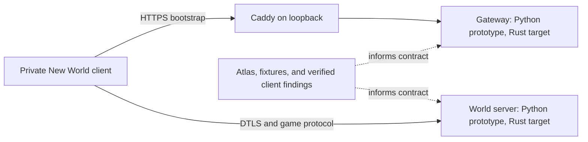

# Architecture and scaling direction

This is the working design for the private New World emulator. The atlas and
protocol references remain the authority for observed client behavior; this
document sets repository boundaries and the order in which to build them.

For the **absolute platform vision** — playable spine, security/privacy,
ontology OS, full repo reorganization, Docker/Kubernetes scaling, launcher,
admin/command bus, and phase map — see
[`PLAN-master-platform.md`](PLAN-master-platform.md). For crate-level Rust
mechanics see [`PLAN-backend-rust.md`](PLAN-backend-rust.md). This file stays
short; those plans win on product and runtime detail respectively.

## Keep the client contract, simplify the server internals

The goal is to reproduce what the shipped client can observe: endpoint paths,
wire fields, authentication flow, state transitions, replication messages,
content identifiers, and gameplay rules. The emulator does not need to copy
AWS's internal service topology when one Azoth process can produce the same
client-visible result. Add a behavior only when client evidence or an explicit
game feature needs it.

“Native” means the client sees the protocol and game behavior it expects. Any
intentional extension should be called out as an extension. Keep development
tools, decompilers, Frida, capture code, content editors, and operator commands
outside the server runtime.



## Repository ownership

| Area | Owns |
| --- | --- |
| `services/gateway/` | HTTP bootstrap and account/session endpoints currently required by the client |
| `services/world/` | Current Python prototype for DTLS, REP, replication, and world rules |
| `server/` | Rust workspace (`channeld`, `regiond`, `worldd`, crates); authoritative runtime target |
| `research/atlas/` | Observed wire contracts, schemas, errors, client functions, and debug levers |
| `research/docs/` | Focused protocol and investigation references |
| `reverse/tools/` and `reverse/probes/` | Static analysis and explicit live-client research |
| `private-client/` | Ignored private executable, profile, and logs; never modify Steam's install |
| `.azoth/` | Ignored toolchain, Caddy data, process state, logs, caches, and temp files |
| `az.py` | One entry point for setup, lifecycle, probes, and common research workflows |

Keep the current gateway and world boundaries while their protocols are
different. Avoid a service per endpoint, packet, or game feature. On the Rust
port, begin with one `world` executable and split code only where ownership or
measurement shows a stable boundary. Cargo workspaces share one lockfile and
build output while allowing packages to be selected independently; use that
mechanism for real modules rather than creating crates for every folder. See
the [Cargo workspace reference](https://doc.rust-lang.org/cargo/reference/workspaces.html).

## Rust runtime shape

When protocol behavior is understood well enough to port, put the Rust backend
in a workspace with only the boundaries the implementation needs:

```text
server/
  Cargo.toml
  apps/
    gateway/       # HTTP entry point if it remains a separate process
    world/         # world process entry point
  crates/
    protocol/      # codecs and exact client wire types
    simulation/    # authoritative state and game rules
    content/       # IDs, data loading, and validation
```

This is a target shape, not a requirement to create empty crates now. A crate
must own code with a distinct reason to change. Keep Frida, Ghidra helpers,
packet tooling, admin controls, and content authoring out of the `world` binary.
The runtime gets bounded operational metrics and configuration, but no research
or developer-only endpoints.

Port incrementally. For each behavior, keep a captured or constructed fixture,
the Python result, and the Rust result comparable at the wire boundary. Move a
handler only after its request fields, response fields, error paths, and state
effects have evidence. Keep exact client property spelling and packet bytes;
do not turn decompiler guesses into protocol fields.

## Content changes

Classify a requested change before coding:

- If the client already understands the content format and IDs, author data,
  validate it, and keep stable source IDs through packaging.
- If the client understands the feature but needs new authoritative behavior,
  implement that rule in the world server and keep the existing wire contract.
- If the client cannot represent the feature, the client asset/runtime also
  needs a change; a server-only packet cannot create a missing client feature.

Keep source content and generated runtime data distinct. Validate references,
IDs, required fields, and package output at the boundary. Do not build a generic
content DSL or editor before repeated real content work demonstrates the need.
The [O3DE asset pipeline](https://www.docs.o3de.org/docs/user-guide/assets/pipeline/)
and [Gems](https://www.docs.o3de.org/docs/user-guide/gems/) distinguish source
assets from runtime products; Veloren's [item](https://veloren.gitlab.io/book/contributors/modders/items-in-plugins.html)
and [weapon-skill](https://veloren.gitlab.io/book/contributors/guides/adding-weapon-skills/guide.html)
guides illustrate the difference between adding supported data and adding new
game behavior. These are organizational examples, not evidence that their
formats or extension APIs apply to New World.

## Reverse engineering and decompilation

Every analysis run identifies the executable by its full SHA-256. Store the
Ghidra project, function-range inventory, pseudocode, indexes, failures, and
retry state under ignored `reverse/builds/<sha256>/`. Existing per-user output
is preserved by `python az.py migrate` under ignored `.azoth/archive/`; it is
historical material, not input to a new build's analysis.

Track four different claims separately:

1. **Range coverage:** every executable function range is accounted for once.
2. **Decompiler outcome:** success or failure for each range, with retries for
   failures and a final count.
3. **Candidate naming:** string, reflection, import, and type evidence proposes
   a useful name.
4. **Verified meaning:** a person checks the body and an independent signal
   such as a caller, log, captured packet, or private-client behavior.

Ghidra pseudocode can support complete range coverage; it cannot recover the
original source with guaranteed types and names or prove every statement is
semantically correct. Keep candidate output generated and put only checked
names and behavior in `research/atlas/client-functions.json`. The maintained
entry point is `python az.py re list`; a full corpus run remains explicit
because it is long and creates substantial local output.

## Capacity gates: 2,500 first, 10,000 target

The goal is 2,500 concurrent players per world process first, then 10,000.
Neither is a current capacity claim. Test on the intended server hardware with
a fixed, repeatable workload that includes login, idle sessions, movement,
combat/replication, uneven zone distribution, disconnects, and reconnect
bursts. Record the workload and build alongside results.

At each gate, measure at least:

- active sessions and packet/byte rates in both directions;
- tick or simulation-step duration, missed deadlines, and p50/p95/p99 latency;
- queue depth and dropped/backpressured work;
- CPU, resident memory, allocation rate, and memory per active player;
- reconnect success and stability over a sustained run.

Optimize measured bottlenecks: packet encoding, allocations, interest filtering,
simulation hot paths, and scheduling. Do not introduce sharding or a distributed
state service until profiling shows one process is the limiting boundary.
Tokio's guidance is to bound concurrency, open sockets, and channel queues;
unbounded queues can consume all memory under load. Use latency histograms so
results can be aggregated across processes rather than comparing averages
alone. See [Tokio bounded channels](https://tokio.rs/tokio/tutorial/channels) and
[Prometheus histograms](https://prometheus.io/docs/practices/histograms/).

## Local setup and lifecycle

Run `.\az.ps1 setup` from a clean Windows checkout. It verifies the official
[CPython 3.14.8](https://www.python.org/downloads/release/python-3148/) installer
SHA-256, installs Python under ignored `.azoth/`, then
installs the pinned tools and Python packages. `toolchain.lock.json` records
the versions and upstream hashes; `python az.py setup --update` refreshes the
Ghidra, JDK, Caddy, and pinned PyPI package versions from upstream feeds. The
CPython runtime version is advanced explicitly in that lock. New World remains
an official Steam install and is discovered by the launcher. Its private copy and profile stay
ignored inside this checkout.

On this existing machine, close NewWorld and any process using the old analysis
workspace, then run `python az.py migrate` once. The private executable and
profile move under ignored `private-client/`; old tools, logs, and decompilation
output move under ignored `.azoth/`. A clean checkout does not depend on
AppData: setup and launch use repository-local paths.

`python az.py dev` owns Caddy, gateway, and world as hidden background
processes. Caddy's data and config directories are explicitly redirected into
`.azoth/` using the supported XDG variables; its listeners bind only to
loopback. `python az.py game` manages the separate private client. Caddy's
`run` command is kept under Azoth's process supervisor because Caddy documents
that its background `start` command is discouraged on Windows: the child stays
attached to the launching terminal. See Caddy's [data-directory conventions](https://caddyserver.com/docs/conventions)
and [command-line reference](https://caddyserver.com/docs/command-line).

## Upstream references checked for this design

- [Cargo workspaces](https://doc.rust-lang.org/cargo/reference/workspaces.html)
  for the future Rust package boundary.
- [Tokio backpressure and bounded channels](https://tokio.rs/tokio/tutorial/channels)
  for explicit concurrency and queue limits.
- [Prometheus histograms](https://prometheus.io/docs/practices/histograms/)
  for aggregatable latency distributions.
- [Amazon GameLift server process configuration](https://docs.aws.amazon.com/gameliftservers/latest/developerguide/fleets-creating.html)
  as an example of external process orchestration; its per-session process
  model is not a capacity prescription for Azoth.
- [Caddy data and config locations](https://caddyserver.com/docs/conventions)
  and [Caddy CLI behavior](https://caddyserver.com/docs/command-line) for
  repo-local state and hidden Windows lifecycle.
- The lock dated 2026-10-06 pins Ghidra
  [12.1.4](https://github.com/NationalSecurityAgency/ghidra/releases/tag/Ghidra_12.1.4_build),
  Temurin JDK [25.0.4.1+1](https://github.com/adoptium/temurin25-binaries/releases/tag/jdk-25.0.4.1%2B1),
  Caddy [2.11.7](https://github.com/caddyserver/caddy/releases/tag/v2.11.7),
  [pyOpenSSL 26.4.0](https://pypi.org/project/pyOpenSSL/26.4.0/),
  [Frida 17.21.0](https://pypi.org/project/frida/17.21.0/), and
  [Pillow 12.3.0](https://pypi.org/project/Pillow/12.3.0/). `toolchain.lock.json`
  carries the archive SHA-256 checksums; `python az.py setup --update` resolves
  current upstream stable releases and rewrites the lock.
