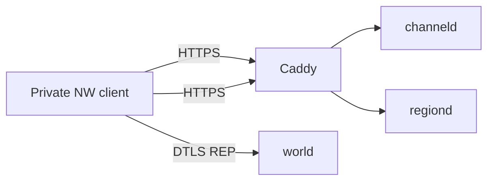

# Architecture

Short boundaries. Product / reorg / security vision:
[`PLAN-master-platform.md`](PLAN-master-platform.md). Tick / wire / DTLS:
[`PLAN-backend-rust.md`](PLAN-backend-rust.md).

## Ownership (disk today)

| Path | Owns |
| --- | --- |
| `server/apps/channeld` | Platform HTTP (images, channel surface) |
| `server/apps/regiond` | Discovery, login, tickets, remote config |
| `server/apps/worldd` | Authoritative world: DTLS + REP + tick (**no replay pump**). Public binary name → `world` (ADR 0006) |
| `server/crates/azoth-wire` | Codecs / bytes only |
| `server/crates/azoth-model` | Domain ids / transforms |
| `server/crates/azoth-session` | Tickets, session state machine |
| `server/crates/azoth-dtls` | OpenSSL DTLS isolation (ADR 0004) |
| `server/crates/azoth-http` | Shared HTTP helpers |
| `server/crates/azoth-store` | Persistence |
| `server/crates/azoth-region` | Region placement helpers |
| `server/crates/azoth-commands` | Typed admin/player commands + RBAC |
| `server/crates/azoth-privacy` | Profile visibility policy |
| `services/gateway`, `services/world` | Python prototype — **transitional** play path until R7 |
| `research/atlas/` | Durable facts + ontology |
| `reverse/` | RE tools / probes / per-SHA corpora (gitignored builds) |
| `platform/` | Launcher + web product surfaces (skeletons) |
| `deploy/local/` | Compose one-box |
| `site/` | Public landing / roadmap v2 |
| `private-client/`, `.azoth/` | Gitignored runtime |

## Rules

- Domain never invents wire offsets; wire never owns game rules.
- Capture seeds are temporary; ontology names purpose.
- Ops/admin never rides the sim tick (`ops` process later).
- Steam install is read-only; clone-anywhere via `az setup` + `az doctor`.
- Linux containers are a first-class server target; Windows hosts the private client.
