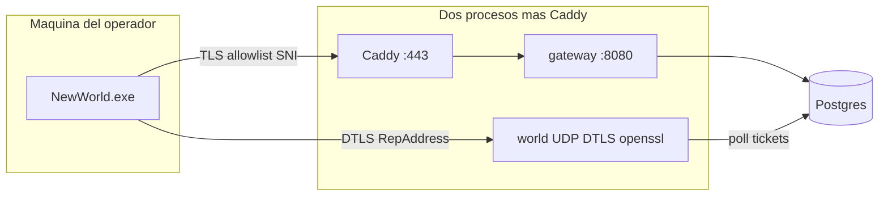

# New World Private Server — Arquitectura del emulador

| Campo | Valor |
|---|---|
| **Título** | Emulador privado de New World: Aeternum — diseño de arquitectura |
| **Autor** | operador del repo |
| **Fecha** | 2026-09-06 |
| **Estado** | Draft (rev. 5, marca Azoth, submódulos research/emulator/launcher) |
| **Repo** | `C:\Users\ivang\Desktop\Dev\NewWorldPrivateServer` |
| **Juego** | New World: Aeternum, Steam App ID `1063730` |
| **Cliente** | `[RETAIL].Javelin.1.400.6031.6004151` (compilado 2026-03-21), Lumberyard `1.12.0.1` / Javelin |
| **Instalación** | `C:\Program Files (x86)\Steam\steamapps\common\New World` |
| **Cierre oficial** | **31 de enero de 2027** |
| **Anti-cheat** | Easy Anti-Cheat EOS, `productid b0855340e2ed491096135339f6fc94b7` |

Este documento responde tres preguntas del operador, fija la arquitectura del emulador, y define el layout del monorepo. Es el **contrato de implementación**. Copia canónica en el repo: `docs/ARQUITECTURA.md`. `docs/ANALISIS.md` queda como mapa histórico del cliente live; no se borra.

---

## Overview

No tenemos “todo lo necesario para terminar el emulador”. Tenemos **suficiente para empezar el mock HTTPS y el pipeline de captura**, y un mapa honesto de lo que falta (cuerpos JSON de login, plaintext DTLS, pin de certificado REP, simulación). El cliente Steam que ya poseemos no se crackea: se le habla en su idioma, modelo TrinityCore.

Hay **dos perfiles que nunca se mezclan**.

- **Captura official** (hasta 2027-01-31, misma cuenta Steam que aún juega Amazon): Steam → `NewWorldLauncher.exe` → EAC EOS → `NewWorld.exe`. Hosts limpio. Cero parches, cero skip-EAC, cero Frida. Solo captura pasiva.
- **Emulador private** (nuestro backend): lanzar `Bin64\NewWorld.exe` **directo**, saltando el launcher y EAC EOS. Steam puede seguir abierto por `steam_api64.dll`. Esta copia habla **solo** con nuestro gateway/world. Aquí sí: parche de URL de channel, pin DTLS, CA bundle, debugger/Ghidra/Frida contra *nuestro* proceso.

Hosts+CA **sigue existiendo** (cero parche si el exe honra el Root de Windows). Skip-EAC **no está medido** en este build 1.400: hay un spike (`tools/launch/Start-NwPrivate.ps1`) antes de dar por bueno el camino private. Nunca un exe parcheado / sin EAC contra hosts de Amazon.

El día 1 no son “docenas de servicios”. Son **dos procesos de aplicación y una base de datos**, con Caddy como terminator TLS: gateway Python en `:8080` (auth, personajes, cola, CMS, entitlements, remote-config) y world Rust (openssl DTLS + sim + AOI) sobre UDP. El código se parte en **tres git (submódulos)**: `research/`, `emulator/`, `launcher/`. Marca **Azoth**, mundo `azoth-1`. En private **no se usa Steam**. La decompilación vive en `research/tools/decomp`.

---

## Background & Motivation

Amazon delistó New World el 15 de enero de 2026. Los servidores oficiales cierran el 31 de enero de 2027. Cada sesión live es protocolo irrecuperable. Hoy el cliente de esta máquina **sí entra** a oficial: dos capturas con pcap (`captures/live_20260906_155045`, `captures/live_20260906_160330`) cubren login Steam → Omni → cola → REP → spawn → `InGame`, más creación de personaje (`Nozusss` en `FTUE_V2_CC`) y cambio a `xNozus`.

El cliente es un monolito x64 (`Bin64/NewWorld.exe`, ~179 MB) con ASLR + DEP. `EasyAntiCheat/Settings.json` declara `executable: Bin64/NewWorld.exe`; el launcher lo envuelve con EAC EOS. El driver registra `ObRegisterCallbacks` y recorta `PROCESS_VM_READ` / `PROCESS_VM_WRITE` **cuando EAC está vivo**. Captura pasiva es el único camino **mientras se juegue en oficial**. En el perfil private (exe directo, sin EAC) debugger/RPM/Frida contra *nuestro* proceso está permitido. `tools/re/memory.py` se niega a RPM si detecta EAC EOS; el launch private no arranca EAC.

Amazon en producción usaba 4 REPs, 7 hubs EC2, Lambda/API Gateway y DynamoDB (~2500 jugadores + ~7000 AI por mundo, re:Invent 2021). Eso **no** es la forma del private server el día 1. El contrato con el cliente sí: empujar `GameConnection` por la misma escalera de estados, con los JSON y los paquetes que cada transición espera.

Dolor actual:

- El repo es un semillero útil (`docs/`, `tools/`, `captures/`) mezclado con artefactos crudos. **Ya existe** `.gitignore` (`captures/*` default-deny, `*.pcapng`, `*.etl`, `__pycache__/`). No hay `.git` todavía, así que nada está commiteado; PR-01 **reemplaza** ese ignore, no parte de cero. `Game.log.raw` y pcaps no deben versionarse (tickets Steam).
- `identities.json` pisa el personaje: en `live_20260906_160330` se perdió `Nozusss` a favor de `xNozus`.
- Los cuerpos HTTPS de login siguen en TLS. El mock los descubrirá cuando el cliente nos hable.

---

## Respuestas directas (las tres preguntas)

### 1. ¿Ya tenemos todo lo necesario para construir el emulador?

**No. Tenemos suficiente para empezar, no para terminar.**

**Sí tenemos (evidencia en este repo):**

| Pieza | Dónde | Qué cubre |
|---|---|---|
| Escalera `GameConnection` | `captures/live_20260906_160330/extracted/state_machine.jsonl`, `REPORT.md` | `Disconnected → QueryGameUpdateCheck → QueueGameLogin → WaitingForQueuedLogin → QueryForRemoteConfigClass → WaitingForRemoteConfigClass → ObtainREPRequirements → StartREPConnection → WaitingForREPConnection → WaitingForActorGameConnection → WaitingForSpawnPoint → WaitingForPlayerSpawn → InGame`. También `InGame → WaitingForPlayerSpawn` en cambio de mapa y `InGame → Disconnected` al cambiar de mundo. |
| Channel config completo | `_re/channel_config.json`, `captures/live_20260906_160330/extracted/remote_json/channel.json` | Clusters `fra/gru/iad/pdx/syd-prod`, Omni metadata (`tokenservice.amazongames.com`, `prod.newworld.com`). |
| CMS plaintext | `captures/live_20260906_160330/extracted/remote_json/{news,tiles,motd}.json` | News, marketing tiles, MOTD. ETag obligatorio (sin ETag el cliente crashea). MOTD polleado ~60 s. |
| Catálogo de hosts (38) | `captures/live_20260906_160330/extracted/endpoints_catalog.json` | Auth stack, loginGateway, JavelinGateway CF, CMS, entitlements, catalog, privacy, identity, Vivox, EAC datarouter, STS. **No** incluye `ags-javelin-remote-config.s3.amazonaws.com` (sí está en `tools/re/common.py` `ENDPOINT_ROLES`). El catálogo **no** es la allowlist de hosts. |
| Forma Vivox | `captures/live_20260906_160330/logs/events.jsonl` (91 eventos) | Login `.amazon9050-ne28.<characterId>+B.`, SIP `sip:confctl-d-amazon9050-ne28.<gridId>_<token>@nwxp0euc1.vivox.com`. Puertos UDP **vistos en esta sesión**: 27020, 27022, 27024, 27026 (`client_expect.json` `pcap_udp_voice_ports`). 27018 **no** apareció aquí. |
| Nombres RMI | `REPORT.md` | `GlobalStorageComponentClientFacet_ReceiveStorageSearchItems` (26), `GatherableControllerComponentClientFacet_GatheringInterrupted` (15), `EventNotificationComponentClientFacet_SyncNotifications`, `GridTrackingComponentClientFacet_UpdatePhasing`, `GameModeParticipantComponentClientFacet_OnLeftQueueForGameModeMsg`. |
| REP UDP/DTLS | `captures/live_20260906_160330/network/pktmon.analysis.json` | Cipher `ECDHE-RSA-AES256-GCM-SHA384` (de `docs/ANALISIS.md`). Flujos `52.223.18.203:48274` (Nozusss, 35177 pkts, 16 DTLS hellos) y `:33000` (xNozus, 6947 pkts). Ticket `worldId_uuid`. `RepAddress` efímero. SNI HTTPS extraído: **ninguno**. |
| Toolkit de captura | `tools/capture/`, `tools/re/` | `Start-NwCapture.bat/ps1`, `nw_capture.py`; disk, strings, net, endpoints, log, eac; `memory.py` rechaza RPM live. |
| GridMate público | `docs/ANALISIS.md` §3 | Fork MIT Lumberyard (`Code/Framework/GridMate/`): Carrier, replicas, endianness BE, VLQ, bools a bit. |
| Mundo en disco | PAKs = ZIP | El servidor **no envía el mapa**. Envía `LevelInfoChanged` + réplicas. Cliente carga `NewWorld_VitaeEterna` / `FTUE_V2` / `FTUE_V2_CC` / `NW_Frontend_NightHaven`. |
| Contrato de login inferido | `captures/live_20260906_160330/extracted/client_expect.json` | Qué JSON tenemos en claro vs qué sigue TLS. |

**No tenemos (bloquean “emulador hecho”):**

| Hueco | Severidad | Cómo se cierra |
|---|---|---|
| Cuerpos HTTPS de `/prod/credentials/omni`, `getlogininfo`, create/validate character, `login/queue/v2` | Alta | El cliente los pedirá a **nuestro** mock. Game.log solo imprime efectos (ticket, `RepAddress`, character id), no el JSON. |
| Cuerpos S3 `remoteCfg` | Alta (acoplado a Omni) | Tamaños conocidos: 190, 542, 1070, 1856, 872, 5887, 146 bytes. `{}` **puede ser demasiado pequeño**. El mock sirve el keyspace S3; tamaños capturados son fallback de longitud, no conjetura de forma JSON. Ver contrato Omni+S3+SigV4. |
| Plaintext DTLS / Carrier Javelin del pcap oficial | Alta | Ciphertext. Tamaños, hellos, IPs. El decode real llega cuando **nosotros** terminamos DTLS. |
| Pin del certificado DTLS | Alta — problema duro de REP | Un cert self-signed aleatorio falla `unknown ca` / `@mm_csdkerr_transport_security_error` (`docs/ANALISIS.md` §2.3). PEM ASCII es el caso improbable; scan DER/PE en PR-06. En perfil **private** (skip-EAC verde): se puede **reemplazar el pin** en la copia privada. En official: no se toca el binario. |
| Skip-EAC en este 1.400 | Media (bloquea parches private) | `Settings.json` apunta a `Bin64/NewWorld.exe`; el launcher lo envuelve. Launch directo **no medido**. Spike PR-03b: arranca, sale, o hace falta un nop del init EAC **solo en la copia private**. |
| Lista completa de paths HTTP de character create | Media | Game.log **no imprimió la URL**. Ocurrió durante el mapa `FTUE_V2_CC` (14:06:09–14:06:55). Tras create: `Connect playerName=Nozusss character=abdbd9e8-50f8-4c05-a41b-3f17e9b0407e`. |
| Simulación | Alta (post-spawn) | Física, combate Slayer Script en server, AI, inventario, trading, companies, war, dungeons. Fuera del MVP de spawn congelado. |

Conclusión operativa: **Fase 1 (gateway HTTPS) se puede empezar hoy**. Fase 2 (REP stub) se puede diseñar hoy y se implementa cuando el cliente apunte a localhost y nos entregue el handshake. “Emulador jugable” es meses, no un sprint.

### 2. ¿Sabemos cómo modificar el launcher para que apunte a nuestro backend?

**No modificamos el launcher.** En official ni se toca. En private **no se usa**: se lanza `Bin64\NewWorld.exe` directo.

Cadena **official** (capturada, `STATUS.txt` de 160330: `steam:3312, eac-eos:24316, client:248`):

```
Steam → NewWorldLauncher.exe → EasyAntiCheat_EOS_Setup.exe install <productid>
      → EasyAntiCheat_EOS.exe → Bin64/NewWorld.exe (protegido)
```

Cadena **private** (objetivo, **no medida aún** en 1.400):

```
Steam (abierto, steam_api64.dll) → tools/launch/Start-NwPrivate.ps1
      → Bin64\NewWorld.exe   (sin NewWorldLauncher.exe, sin EasyAntiCheat_EOS.exe)
      → nuestro Caddy :443 / world UDP
```

Parchear el launcher o el exe **mientras EAC habla con Epic/Amazon** sigue prohibido (`docs/EAC_Y_MEMORIA.md`, `docs/CAPTURA.md`). No hay modo “undetected”. El skip-EAC **no** es un bypass stealth: es no arrancar el bootstrap cuando el cliente solo habla con nosotros.

Dos formas de apuntar al backend (complementarias, no excluyentes):

1. **Hosts+CA** (cero parche): allowlist → `127.0.0.1`/`::1`, Caddy `:443`. Útil aunque skip-EAC falle (entonces solo con **segunda cuenta Steam**, riesgo Alta).
2. **Parche de la copia private** (si el spike skip-EAC es verde): reescribir la URL CloudFront del channel config y/o el pin DTLS **en una copia** del exe, nunca en el árbol Steam que usa official. Independiente de hosts.

`switch-mode.ps1` **rechaza** exe parcheado + hosts official, y `Start-NwPrivate.ps1` + modo official.

### 3. ¿Hay que decompilar el juego/launcher para retargetear endpoints?

**No como prerrequisito del mock HTTPS. Sí como workstream private en paralelo, en cuanto skip-EAC esté verde.**

- **Perfil official (Amazon, EAC vivo):** redirect sin tocar binarios. Captura pasiva. RE estático del exe **como archivo** (`tools/re/strings.py`, `disk.py`) permitido.
- **Perfil private (nuestro server, exe directo):** Ghidra, parche de URL de channel, reemplazo de pin DTLS, debugger/Frida contra *nuestro* proceso. Eso era “workstream B después de que muera official”; ahora es **Fase A-private**, en cuanto el spike PR-03b sea verde. El Steam install de captura se deja **vanilla**.
- **Workstream B restante:** loop IA de decompilación “entera”, mods de PAK profundos, parche de pin si skip-EAC **falló** y hay que esperar a official apagado. Paralelo a fases de producto 5–6; **no** es la Fase 5 de sistemas.

Decompilar el monolito de 133 MB de `.text` “entero” no es un plan. Se entra por strings del log y por `typeindex.json` (7052 AZ UUIDs). GridMate público es la piedra de Rosetta del Carrier.

---

## Goals & Non-Goals

### Goals

- Private server al que el **cliente ya poseído** se conecta. Modelo TrinityCore, no crack.
- **Dos perfiles:** official (launcher+EAC, captura pasiva) y private (`NewWorld.exe` directo, nuestro backend). Nunca mezclados.
- Gateway HTTPS local que complete la escalera hasta `StartREPConnection` con `RepAddress` nuestro.
- World process que complete DTLS + Carrier + V3 + `LevelInfoChanged` + `Cmd_NewProxy` del player → `InGame` con personaje congelado (MVP de spawn).
- Captura pasiva continua en official mientras Amazon viva (cierre 2027-01-31).
- Spike skip-EAC medido; si es verde, parche de URL/pin **solo** en copia private.
- Monorepo ordenado: dos binarios, módulos internos, tools/docs existentes conservados.
- Operator docs: voltear official vs private. `switch-mode.ps1` rechaza exe parcheado + hosts Amazon.

### Non-Goals (explícitos)

- No bypass stealth de EAC, no “undetected”, no Frida/inject/parche **mientras se juegue en oficial** (Amazon).
- No documentar cómo ocultarse de EAC en official.
- No lanzar exe parcheado o skip-EAC contra hosts de Amazon.
- No atacar API Gateway / REP de Amazon.
- No reenviar tickets Steam a Amazon.
- No publicar un crack del exe.
- No clonar 4 REPs + 7 hubs + Lambda el día 1.
- No 20 carpetas vacías de microservicios.
- No git submodules en v1.
- No voz Vivox funcional el día 1 (stub o ignorar).
- No simulación de combate/AI/war/trading en el MVP.
- No commitear `Game.log.raw`, `*.pcapng`, `*.etl`, tickets Steam, ni el exe parcheado.

---

## Proposed Design

### Decisión de redirección (Key Decision)

```mermaid
sequenceDiagram
    autonumber
    participant Steam
    participant Launch as Start-NwPrivate.ps1
    participant Client as NewWorld.exe (copia private)
    participant Caddy as Caddy :443
    participant GW as gateway :8080
    participant World as world UDP/DTLS
    participant PG as Postgres

    Note over Steam,Client: Perfil private. Sin launcher. Sin EAC. Steam abierto por steam_api64.
    Steam->>Launch: Steam running
    Launch->>Client: Bin64\\NewWorld.exe directo
    alt URL parcheada en copia private
        Client->>Caddy: GET channel JSON (host nuestro o CloudFront reescrito)
    else hosts+CA (cero parche)
        Client->>Caddy: GET d2c74t4zimux3r... via 127.0.0.1 / ::1
    end
    Caddy->>GW: HTTP proxy (h1 o h2 según ALPN)
    GW-->>Client: channel config (1 cluster → nosotros)
    Client->>GW: Omni tokens + /prod/credentials/omni
    GW-->>Client: STS-shaped creds (no se verifican; S3 nuestro)
    Client->>GW: CMS news/tiles/MOTD (ETag)
    Client->>GW: S3 remoteCfg
    Client->>GW: getlogininfo / characters
    GW->>PG: accounts + characters
    Client->>GW: POST login/queue/v2
    GW-->>Client: ticket worldId_uuid, RepAddress=127.0.0.1:port
    Client->>World: DTLS ECDHE-RSA-AES256-GCM-SHA384 (openssl; pin nuestro si parche)
    World-->>Client: Carrier CONNECT_ACK + V3 + LevelInfoChanged + NewProxy
    Client-->>Client: InGame (PAK local)
```

Perfil **official** (no dibujado): Steam → `NewWorldLauncher.exe` → EAC EOS → `NewWorld.exe` vanilla, hosts **limpio**, Amazon. Solo `tools/capture`.

**Fase A-official — captura (hasta 2027-01-31):**

1. Hosts limpio. Launcher+EAC. Cero parches. `memory.py` refuse. Agotar CAPTURA 2–6 en esta cuenta.

**Fase A-private — emulador (paralela, nuestro backend):**

1. Spike skip-EAC (`Start-NwPrivate.ps1`): Steam abierto, `NewWorld.exe` directo desde el install. Log: ¿aparece proceso EAC? ¿Game.log llega a channel-uri / frontend? Resultados posibles: arranca al frontend; sale porque el SDK EAC falla; hace falta nop del init EAC **solo en copia private**.
2. Hosts+CA **sigue** disponible (cero parche si Schannel funciona). Spike TLS igual que antes.
3. Si skip-EAC **verde**: parche de URL de channel y/o pin DTLS **en copia private** (`private-client/`, gitignored). El árbol Steam de official se deja vanilla. Ya no es workstream B.
4. Si skip-EAC **rojo**: fallback hosts+CA con EAC vivo **solo en segunda cuenta Steam**. No skip-EAC contra Amazon.
5. Caddy `:443` → Python `:8080`. `RepAddress` = bind UDP nuestro. Steam ticket local; no lo validamos con Amazon.
6. `switch-mode.ps1 official` restaura hosts y **niega** `Start-NwPrivate` / exe parcheado. `private` escribe allowlist (si se usa) y permite el launch script.

**Workstream B — lo que sigue esperando official apagado (o skip-EAC rojo):**

- Loop IA de decompilación “entera”, mods de PAK profundos.
- Parche de pin **si** skip-EAC falló y no hay copia private depurable.
- Ghidra/Frida **sí** están permitidos ya en A-private cuando el spike es verde.

### Por qué no “docenas de servicios”

Amazon partió login, personajes, trading, compañías, entitlements, CMS, remote-config, voz y simulación en Lambdas y hubs porque operaba a escala global. Un private server de 1–50 jugadores el día 1 **no** tiene ese problema. Cada proceso extra es: puerto, healthcheck, contrato de red, CI, y un sitio más donde el JSON que aún no tenemos puede divergir.

Día 1 / MVP (refina `docs/ANALISIS.md` §5):

```
Cliente --HTTPS--> Caddy :443  -->  gateway Python :8080
                   (auth, characters, queue, CMS, entitlements, remote-config S3)
                   Postgres (accounts, characters, worlds, tickets)
Cliente --DTLS-->  world Rust (openssl DTLS + Carrier + replicas) UDP
                   in-memory + Postgres write-behind (poll de tickets)
                   Redis: más tarde, no ahora
```

Dos procesos de aplicación + un terminator TLS + una DB. Caddy no es un microservicio de negocio: es el listener 443/HTTP2. Split posterior: instance workers para dungeons, luego hubs espaciales. **No** se crean 20 carpetas vacías. Módulos **dentro** de los dos binarios (ver árboles gateway y world).



### Lenguajes

| Pieza | Elección v1 | Motivo |
|---|---|---|
| Terminator TLS | **Caddy** (compose, `:443`) | SNI, ALPN h1/h2, Python sin admin en 443. rustls del gateway no entra. |
| Gateway | **Python** (FastAPI o Starlette + uvicorn en `127.0.0.1:8080`, HTTP claro detrás de Caddy) | El 90 % del trabajo próximo es JSON que **aún no tenemos**. `docs/ANALISIS.md` §5.3 lo permite. Reescritura a Rust (`axum`) cuando el schema cierre. |
| World / REP / sim | **Rust** + **openssl** (crate `openssl` / `tokio-native-tls` sobre OpenSSL, o `s2n-tls` si openssl se atasca) | Tick **30 Hz**, un hilo de sim, **sin GC**. Densidad > CCU: ver `emulator/docs/PERFORMANCE.md`. **rustls no habla DTLS 1.2**. C++ solo si el crate DTLS no da el cipher. |
| Cipher DTLS | `ECDHE-RSA-AES256-GCM-SHA384` | Hay que **habilitarlo explícito** en OpenSSL moderno (suite RSA-key-exchange, default menguante). |
| Persistencia | PostgreSQL | Cuentas, personajes; inventario y world_state después. |
| Hot state | Memoria del world process + write-behind | Redis opcional cuando haya más de un worker. |
| HTTP schemas | `schemas/` (JSON Schema) | El gateway Python los consume. **No** hay crate compartido gateway↔world. |
| Wire DTLS/Carrier | `apps/world` + `libs/protocol` (Rust, **solo world**) | El gateway no interpreta Carrier. |

### Layout (paraguas + 3 submódulos)

Decisión de producto (rev. 4): **tres git independientes**, no un único árbol. El paraguas documenta el sistema y fija los gitlinks. Ciclos de vida distintos: captura muere con Amazon; el emulador y el launcher siguen.

```
NewWorldPrivateServer/                 # git paraguas (producto: Azoth)
  docs/                                # NOMBRE, ARQUITECTURA, INDEX, ROADMAP
  research/                            # SUBMODULE — RE, kit, sessions/
    docs/
    tools/capture/                     # Start-NwCapture.bat
    tools/re/
    tools/decomp/
    schemas/live/
    fixtures/
    sessions/                          # dumps crudos, gitignored
  emulator/                            # SUBMODULE — gateway + world
  launcher/                            # SUBMODULE — Play / updater
  private-client/                      # gitignored
```

URLs relativas (`./research`, `./emulator`, `./launcher`). Clone: `git clone --recurse-submodules`.

`.gitignore` **ya existe** (default-deny `captures/*`, `*.pcapng`, `*.etl`, `__pycache__/`, `.venv/`). PR-01 lo **reemplaza**, no lo inventa. Política:

```
# default-deny de sesiones crudas (se conserva)
captures/*
!captures/.gitkeep
!captures/**/REPORT.md
!captures/**/extracted/*.json

# dumps que pueden llevar steam| / PEM / Omni bodies
captures/mock_discovery/
**/mock_discovery/
apps/gateway/fixtures/discovery/
captures/**/static/
captures/**/files/
captures/**/*.raw
tools/capture/.last-session

# red / binarios
*.etl
*.pcap
*.pcapng
_re/*.exe
_re/*.dll
deploy/certs/*.pem
apps/gateway/certs/*.pem
apps/world/certs/*.pem
private-client/

__pycache__/
*.pyc
.venv/
.env
secrets/
```

Allowlist de `extracted/*.json` **después** de un check CI que falle si aparece `steam|` o `ASIA`. Tickets de cola `worldId_uuid` **no** son session tickets Steam; se pueden versionar. Bodies Omni crudos de discovery, no. `TICKET_RE` solo cubre `steam|<hex>` y `ASIA…`.

### Gateway — módulos, no microservicios

Un proceso Python, un árbol:

```
apps/gateway/
  nw_gateway/
    app.py                 # ASGI; Host header (Caddy ya hizo SNI)
    modules/
      channel.py           # GET /STEAM_APP_ID.1063730.json
      cms.py               # news, tiles, MOTD + ETag
      omni.py              # tokenservice + /prod/credentials/omni
      entitlements.py      # stub 200
      characters.py        # getlogininfo, create, validate
      queue.py             # login/queue/v2 → ticket + RepAddress
      remote_config.py     # keyspace S3; no verifica SigV4
    persistence/
      models.py
      repo.py
    discovery.py           # dump Host, path, Authorization, x-amz-* (gitignored)
```

TLS **no** vive en Python. Caddy termina TLS y proxea a `:8080`.

### Allowlist de hosts (única fuente de verdad)

`deploy/hosts-allowlist.json` es el **único** input de `switch-mode.ps1`. **No** se genera restando comentarios de `endpoints_catalog.json` (38 hosts: incluye STS, Vivox, Epic; **omite** el bucket S3). Derivada de APIs `fra-prod` del channel config + CMS + Omni + entitlements/catalog/privacy/identity + S3 remote-config.

Redirect = sí → líneas `127.0.0.1` **y** `::1` en hosts. Redirect = no → no se toca; el cliente habla con el real (o falla solo).

| hostname | rol | redirect | módulo |
|---|---|---|---|
| `d2c74t4zimux3r.cloudfront.net` | channel-config | **sí** | `channel.py` |
| `d1w0bfy6smo4d1.cloudfront.net` | JavelinGateway-CF / credentials/omni | **sí** | `omni.py`, `queue.py` |
| `u433g9r00c.execute-api.eu-central-1.amazonaws.com` | loginGateway | **sí** | `characters.py`, `queue.py` |
| `2mfrik7h83.execute-api.us-east-1.amazonaws.com` | authStack | **sí** | `omni.py` |
| `8otrnl8e8d.execute-api.eu-central-1.amazonaws.com` | JavelinGatewayServiceV2 | **sí** | stub |
| `tokenservice.amazongames.com` | Omni tokens | **sí** | `omni.py` |
| `prod.newworld.com` | nwTokenUrl | **sí** | stub |
| `d1hkbwzm1bktgo.cloudfront.net` | CMS | **sí** | `cms.py` |
| `client.content-service.amazongames.com` | imágenes CMS `.dds` | **sí** | fixture/404 |
| `client.entitlementservice.amazongames.com` | entitlements | **sí** | `entitlements.py` |
| `client.catalogservice.amazongames.com` | catalog | **sí** | stub |
| `client.agsprivacysettingsservice.amazongames.com` | privacy | **sí** | stub |
| `prod.identity-service.amazongames.com` | identity | **sí** | stub |
| `ags-javelin-remote-config.s3.amazonaws.com` | remoteCfg S3 (path-style) | **sí** | `remote_config.py` |
| `ags-javelin-remote-config.s3.eu-central-1.amazonaws.com` | remoteCfg S3 (regional, por si el SDK lo usa) | **sí** | `remote_config.py` |
| `sts.us-east-1.amazonaws.com` | STS | **no** (salvo que discovery muestre llamada **después** de poseer S3) | — |
| `nwxp0euc1.www.vivox.com`, `nwxp0euc1-mim.vivox.com`, ELB Vivox | voz | **no** | — |
| `datarouter*.epicgames.com`, `modules-cdn.eac-prod.on.epicgames.com` | EAC telemetry | **no** | — |
| `*.steampowered.com`, `*.steamcommunity.com` | Steam | **no** | — |
| APIs gru/iad/pdx/syd | otros clusters | **no** | channel mock lista un cluster |

Caddy SAN/wildcard cubre **solo** los `redirect=sí`. Internamente un proceso gateway; `Host` selecciona el módulo.

Deny-list operativa (nunca escribir en hosts): Epic/EAC, Vivox, Steam, STS-unless-mocked, IPs sueltas del pcap.

Criterio de hecho Fase 1 (`docs/ANALISIS.md` §6): el cliente llega a `StartREPConnection` apuntando a localhost. Se queda ahí si no hay world. **Ya no habla con Amazon** para login **ni** para remote-config S3. Sigue hablando con Epic (EAC) y Steam.

### World process — contrato mínimo de spawn

Criterio de hecho Fase 2: `Game.log` dice `player spawn succeeds, in game` y carga `NewWorld_VitaeEterna` (o `FTUE_V2` si el ticket lleva `location: @mm_loginservices_location_FTUE000`). El personaje puede estar congelado.

Árbol interno (módulos, no procesos), espejo del gateway:

```
apps/world/src/
  dtls.rs            # openssl DTLS 1.2, cipher ECDHE-RSA-AES256-GCM-SHA384
  carrier.rs         # seq BE, canales, CONNECT/ACK — GridMate público
  registration.rs    # V3; consume login_tickets en Postgres
  replicas.rs        # Cmd_* inferidos (ver abajo)
  levels.rs          # LevelInfoChanged → nombre de PAK local
  tickets.rs         # poll + UPDATE atómico
```

Nombres `SM_CONNECT_*`, `Cmd_Greetings`, `Cmd_NewProxy`, `PlayerManagerSelfIdentification` salen de **GridMate MIT + `docs/ANALISIS.md` §3**, **no** de este pcap (ciphertext). Esta captura nombra: `REP socket connection established`, `registration response from REP`, `spawn point found`, `LevelInfoChanged` (`session_timeline.json`), `InGame`.

Orden observado (sesión 160330, personaje nuevo). Reloj `t+0` = línea `RepAddress =` a `14:07:01.912` (el estado `StartREPConnection` se logueó 23 ms antes, `14:07:01.889`):

```
14:07:01.889  ObtainREPRequirements → StartREPConnection
14:07:01.912  RepAddress = 52.223.18.203:48274          ← t+0.000
14:07:01.921  StartREPConnection → WaitingForREPConnection   t+0.009
14:07:02.230  REP socket connection established                t+0.318
14:07:02.286  registration response from REP                   t+0.374
              Server version [RETAIL].Javelin.1.365.6031.6017213
14:07:02.308  WaitingForActorGameConnection                    t+0.396
14:07:02.439  actor game connection succeeds                   t+0.527
14:07:02.461  spawn point found → WaitingForPlayerSpawn        t+0.549
14:07:03.172  WaitingForPlayerSpawn → InGame                   t+1.260
```

El world **envía** en V3 el string `[RETAIL].Javelin.1.365.6031.6017213` (lo que el REP oficial mandó). El cliente es `1.400.6031.6004151`; oficial **ya** mismatch-ea, así que echo 1.365 es el default seguro. No inventar 1.400 en el server hasta medir.

Capas (de `docs/ANALISIS.md` §3, GridMate MIT):

```
UDP
  DTLS 1.2  ECDHE-RSA-AES256-GCM-SHA384
    Carrier datagram
      [u16 BE seq] [message records…]
      hint compresión 0x00 / LZ4
      4 canales; canal 3 = sistema (connect, acks, clock)
    Aplicación
      SM_CONNECT_REQUEST → SM_CONNECT_ACK (ticket aquí)
      V3 Registration (login ticket + character/world ids)
      Replica stream: Cmd_Greetings, Cmd_NewProxy, Cmd_DestroyProxy,
                      Cmd_NewOwner, Cmd_Heartbeat
      RPCs *ComponentClientFacet / *Messages
```

MVP de spawn (pasos 2–6 **inferidos**; el pcap no los nombra):

1. Terminar DTLS (pin: informe PE-DER, PR-06). **Gate:** no empezar Carrier completo sin ese informe.
2. `SM_CONNECT_ACK` reliable (GridMate).
3. V3 RegistrationResponse aceptada + version string 1.365.
4. `PlayerManagerSelfIdentification` (ANALISIS: avanza 10→11) — **inferido**.
5. `LevelInfoChanged` (esta captura **sí** lo implica: carga `FTUE_V2` / `NewWorld_VitaeEterna`).
6. `Cmd_NewProxy` del actor del jugador (ANALISIS: avanza 13→14 `InGame`) — **inferido**.

AOI, input, física: Fase 3. El mapa **no se envía**.

Ticket de cola (formato observado, no el body HTTP):

```
86ae8332-ed32-420e-985c-61011022847a_e77e270e-b44a-45e1-83f3-6a538a2f230c
^^^^^^^^^^^^^^^^^^^^^^^^^^^^^^^^^^^^ ^^^^^^^^^^^^^^^^^^^^^^^^^^^^^^^^^^^^
worldId                              uuid de sesión
location: "" | "@mm_loginservices_location_FTUE000"
RepAddress: ip:port   (efímero; 23771 / 48274 / 33000 / 58257 vistos)
```

El gateway **emite** el ticket en Postgres (`login_tickets`, FK a `worlds`). El world **poll** la misma DB en la red Docker `nw-private` (no gRPC). Consume con UPDATE atómico. Un ticket, un spawn. No reusar contra Amazon. El bind UDP vive en `worlds.rep_host/rep_port`, no duplicado en el ticket.

### DTLS pin — el problema duro, no se finge

Riesgo **alto**. ANALISIS: un cert self-signed “cualquiera” falla `unknown ca` / `@mm_csdkerr_transport_security_error`. El cliente trae un certificado embebido o un pin.

`tools/re/strings.py` busca ASCII `BEGIN CERTIFICATE`. Pins y CAs embebidas suelen ser **DER** (`0x30 0x82…`), recursos PE, o hashes SPKI — no PEM. Tratar PEM vacío como el resultado **probable**, no como sorpresa.

Plan, en orden:

1. **HTTPS (A-private, hosts+CA):** CA local + Caddy. El cliente **puede** ignorar el Root de Windows. Spike de channel JSON lo mide. Fallback: extraer CA bundle del exe-como-archivo **o**, si skip-EAC verde, parchear el bundle/pin en la copia private.
2. **PR-06 (paralelo, gate de Carrier):** escanear `NewWorld.exe` como archivo: PEM, DER, recursos PE, SPKI hashes. Cruzar con GridMate `SecureSocket`. Informe: `PEM found` / `DER found` / `hash-only` / `none`.
3. **Si skip-EAC verde (PR-03b):** `hash-only`/`none` se resuelve **parcheando la copia private** (Fase A-private / PR-06b), no se espera a que Amazon apague. El world sirve **nuestro** cert; el pin del cliente private coincide.
4. **Si skip-EAC rojo:** el world intenta el cert extraído; si no hay, Carrier se pausa. Fallback hosts+CA+EAC solo en segunda cuenta. Parche de pin en el Steam vanilla = nunca.
5. **No** diseñar bypass EAC para inyectar un cert en memoria del proceso official. En private, Frida/debugger contra *nuestro* proceso está bien.

Comunidad first-light se quedó post-V3. No repetir 8 meses de Ghidra a ciegas.

### Workstream de decompilación (organizar, no empezar el dump)

`tools/re/` ya cubre disco:

| Script | Rol |
|---|---|
| `disk.py` | Snapshot install, PAK index (ZIP), copia `typeindex.json`, `bootstrap.cfg`, `engine.json` |
| `strings.py` | Strings/PE del exe-como-archivo; needles Javelin/GridMate/DTLS/Omni |
| `eac.py` | Lee `EasyAntiCheat/Settings.json` y logs locales. No bypass. |
| `endpoints.py` | Catálogo de hosts por sesión |
| `net.py` | pcapng: SNI, DTLS hellos, flujos UDP |
| `log.py` | Ingest de Game.log (delega a `nw_capture.py`) |
| `memory.py` | **Rechaza** RPM si EAC EOS está vivo (perfil official). En private skip-EAC, debugger/RPM local está permitido |
| `validate.py` | Compila + env check |
| `_fetch_cms.py` | GET público de channel/news/tiles/MOTD |

Futuro `tools/decomp/` (stubs/docs **ahora**, no un proyecto Ghidra de 133 MB):

- Notas de proyecto Ghidra: usables en **A-private** en cuanto skip-EAC esté verde (proceso nuestro, sin EAC).
- Prompts por módulo: `GameConnection`, RMI facets, `OmniAuthBackend`, Carrier connect, init EAC (solo para nop en copia private si el spike lo exige).
- Ingest de `typeindex.json` (mapa de reflexión, input de primera clase).
- Extractor de PAK / LyShine / DataSheet.
- Loop de agentes de IA para “decompilar el juego entero”: **workstream B**, después de nuestro REP. No es la Fase 5 de sistemas de juego.

Fuente pública GridMate (`aws/lumberyard`, MIT) se **lee**, no se submodulea. Si más adelante se forkea, entonces sí un repo aparte.

### Workstream de captura

Se conserva `tools/capture` tal cual. Tres bugs/deudas a corregir (no en este documento más allá del PR plan):

1. **`identities.json` pisa.** En `live_20260906_160330` el último personaje (`xNozus` / `07631b31-…`) sobrescribió `Nozusss` / `abdbd9e8-…`. `session_timeline.json` ya guarda ambos; el watcher debe escribir **lista/historial**, no un dict plano (`nw_capture.py` ~L831–848).
2. **`STATUS.txt` `last_state`.** Imprime el dict `{'from': 'WaitingForPlayerSpawn', 'to': 'InGame'}` entero. Confunde: parece que el estado actual es `WaitingForPlayerSpawn`. Mostrar **estado actual** (`to` del último evento) y, aparte, el último tránsito.
3. **CMS y Vivox son first-class.** 62 eventos CMS y 91 Vivox en 160330 no son ruido. El report ya los cuenta; el watcher no debe filtrarlos como leftover.

Prioridad de sesiones mientras Amazon viva (`docs/CAPTURA.md`):

1. Login hasta InGame — **hecho** (155045, 160330, más `20260906_existing_gamelog`).
2. Movimiento + un combate (RMI `ActorMover`, abilities).
3. Inventario / storage (ya hay `GlobalStorageComponentClientFacet_*`).
4. Cambio de territorio / fast travel.
5. Expedición (otro `level.pak`, posiblemente otro REP).
6. War / crafting / trading.

### Fases de producto (refinadas)

| Fase | Criterio de hecho | Dependencias |
|---|---|---|
| 0 Captura official | Kit live + pcap alineado a Game.log | **Hecho** el login. Agotar prioridad 2–6 en **official** (launcher+EAC, hosts limpio). |
| A-private spike | `NewWorld.exe` directo, sin EAC, llega a channel-uri/frontend | PR-03b `Start-NwPrivate.ps1`. Aún no medido en 1.400. |
| 1 Auth mock | Cliente private en `StartREPConnection` → localhost | Caddy+channel+CMS; hosts+CA y/o URL parcheada si spike verde; Omni+S3+queue |
| 2 REP stub | `InGame`, personaje congelado, mapa cargado | PR-06 pin report + openssl DTLS; **parche de pin en copia private** si spike verde y `hash-only`; Carrier + V3 + LevelInfoChanged + NewProxy |
| 3 Un jugador se mueve | Input → transform replicado | Codec de mover; capturas de movimiento (official) |
| 4 Persistencia + N jugadores | Cuentas, chars, AOI, ver a otros | Postgres (entra en characters); AOI |
| 5 Sistemas de juego | Gathering, crafting, Slayer, AI, quests, war, trading, dungeons | Capturas por sistema |
| 6 Contenido custom | Datasheets + slices + PAK | Server entiende entity defs vanilla |
| Workstream B (paralelo a 5–6, no es Fase 5) | Loop IA decomp “entera”, PAK profundos; parche pin **solo si** skip-EAC rojo | Official apagado, o segunda cuenta + hosts+CA |

---

## API / Interface Changes

No hay API previa en este repo. Contratos que el gateway debe cumplir, con honestidad de schema.

### Channel config (plaintext, lo tenemos)

`GET https://d2c74t4zimux3r.cloudfront.net/STEAM_APP_ID.1063730.json`

Shape real (`_re/channel_config.json`): `channelName`, un objeto por cluster, `platformMetadata.OMNI.STEAM_APP_ID.1063730` (`omniTokenUrl`, `nwTokenUrl`, `omniStage=prod`, `omniGameAlias=new-world`).

Mock v1: un cluster. Los `apiEndpoint` son hostnames que el hosts file resuelve a `127.0.0.1`.

### CMS (plaintext + ETag)

| Recurso | URL |
|---|---|
| News | `/newsstories/STEAM_APP_ID.1063730/metadata.json` |
| Tiles | `/marketingtiles/STEAM_APP_ID.1063730/metadata.json` |
| MOTD | `/motd/worlds_STEAM_APP_ID.1063730.json` |

Respuesta: JSON capturado (o vacío válido) **con header `ETag`**. MOTD se reconsulta ~60 s. Fixture en `schemas/` + `fixtures/cms/`.

### Credentials Omni (body TLS — inferido)

`GET/POST https://d1w0bfy6smo4d1.cloudfront.net/prod/credentials/omni`

Shape esperado (`docs/ANALISIS.md` §2.3, `client_expect.json`):

```json
{
  "AccessKeyId": "ASIA................",
  "SecretAccessKey": "........................................",
  "SessionToken": "<opaque>",
  "Expiration": "2026-09-06T15:00:00Z"
}
```

`AccessKeyId` 20 chars `ASIA…`, secret 40, expiration RFC3339. Refresh ~55 min. Cuenta: devolver `type: "full"` (oficial devolvió `Shadow` + link code `REYSKJDE`; el mock no debe empujar al flujo de vincular Amazon). `ownership=permanent` (visto en `CGame::OnCampfireLoginComplete`).

El schema exacto se **descubre** en `discovery.py` cuando el cliente pegue contra nosotros. `discovery.py` vuelca `Authorization` y todos los `x-amz-*` (gitignored).

**Contrato Omni + remote-config + STS (una sola historia):**

No sabemos aún si el cliente usa esas credenciales como (1) SigV4 contra API Gateway / S3, (2) blob opaco que el mock puede ignorar, o (3) input a `sts.us-east-1.amazonaws.com` real. DNS de la sesión resolvió STS y bajó siete objetos S3 `configuration-sets/.../versionless` con keys Cognito (`poolId` `us-east-1:0de93f7c-814e-4d48-a8fd-b6efc2f9ed93`).

Hipótesis de trabajo v1 (se confirma con dumps):

1. **Asumir SigV4** en S3 y APIs. El gateway **no verifica** la firma (acepta unsigned o firmado).
2. **Siempre** hosts-redirect del bucket remote-config (`ags-javelin-remote-config.s3.amazonaws.com` y variante regional). Si S3 queda en AWS real, las keys fake dan 403 y el cliente no sale de `WaitingForRemoteConfigClass` (cinco loops en `state_machine.jsonl` antes de `ObtainREPRequirements`).
3. **No** hosts-redirect de STS salvo que los dumps muestren una llamada **después** de poseer S3. El SDK puede resolver STS sin usarlo.
4. Egress “fail closed” aplica al **proceso gateway** (no llama a Amazon). El **cliente** sí necesita Steam + Epic; S3 de remote-config es **nuestro**, no un 403 de AWS.

### Remote-config S3 (cuerpos TLS — tamaños conocidos)

Keys vistas (`captures/live_20260906_160330/extracted/client_expect.json` y `events.jsonl`):

```
applications/public/configuration-sets/ProductId/STEAM_APP_ID.1063730/versionless     190 B
applications/public/configuration-sets/RegionId/fra-prod/versionless                   542 B
applications/public/configuration-sets/CognitoId/us-east-1:0de93f7c-…/versionless     1070 B
applications/publicGameplay/configuration-sets/ProductId/STEAM_APP_ID.1063730/versionless 1856 B
applications/publicGameplay/configuration-sets/RegionId/fra-prod/versionless            872 B
applications/publicGameplay/configuration-sets/CognitoId/…/versionless                 5887 B
applications/publicGameplay/configuration-sets/WorldId/86ae8332-…/versionless           146 B
```

También se consultan variantes `WorldIdv` con sufijo `6031;6004151` (pueden 404). `{}` **puede ser demasiado pequeño**. v1: JSON mínimo; si el cliente rechaza, servir blobs opacos del **tamaño capturado** (fallback de longitud, no de forma). El módulo responde GET path-style y virtual-hosted.

### Queue v2 (body TLS — campos del log)

Path inferido: `/prod/game/login/queue/v2/...`

Campos que el cliente **consumió** (log, no el JSON):

```json
{
  "ticket": "<worldId>_<uuid>",
  "location": "" ,
  "RepAddress": "127.0.0.1:24000",
  "WorldId": "<uuid>",
  "WorldName": "private-1",
  "CharacterId": "<uuid>"
}
```

`location` vacío → open world. `@mm_loginservices_location_FTUE000` → tutorial `FTUE_V2`. Nombres de campos HTTP pueden diferir (camelCase vs el log). El mock loguea request/response crudos la primera vez.

### getlogininfo / characters (path no impreso)

Inferido: `/prod/game/getlogininfo/...`, `/characters`, `/characters/validator`.

Evidencia: el frontend listó `Nozusss` (nuevo) y `xNozus` (existente) porque el usuario cambió a las 14:13:46. El create ocurrió en `FTUE_V2_CC` sin URL en el log. El gateway debe:

- Aceptar **cualquier** path bajo los vhosts de login y volcarlo a `captures/mock_discovery/` (**gitignored**; puede contener `steam|`).
- Cuando un path produzca avance de estado en Game.log, fijar schema en `schemas/` y un fixture redactado en `fixtures/`.

### Interfaz interna gateway ↔ world

No gRPC el día 1. Misma Postgres, red Docker `nw-private`. El bind UDP está **solo** en `worlds`. El ticket referencia `world_id`.

Consume atómico (v1 = poll ~100 ms en `tickets.rs`; `LISTEN/NOTIFY` después):

```sql
UPDATE login_tickets
   SET consumed_at = now()
 WHERE ticket_id = $1
   AND consumed_at IS NULL
   AND expires_at > now()
 RETURNING *;
```

0 filas → ticket inválido / ya usado / expirado → V3 reject.

---

## Data Model Changes

Postgres mínimo. No DynamoDB. No inventario el día 1.

```sql
CREATE TABLE accounts (
  id            UUID PRIMARY KEY,
  persona_id    TEXT UNIQUE NOT NULL,          -- amzn1.developerPersonaId.…
  steam_id_hash BYTEA,                         -- NULLABLE: Game.log muestra steam|<hex> (ticket), no un SteamID parseable. NUNCA persistir el blob.
  account_type  TEXT NOT NULL DEFAULT 'full',  -- no 'Shadow'
  created_at    TIMESTAMPTZ NOT NULL DEFAULT now()
);

CREATE TABLE characters (
  id            UUID PRIMARY KEY,
  account_id    UUID NOT NULL REFERENCES accounts(id),
  world_id      UUID NOT NULL,
  name          TEXT NOT NULL,
  appearance    JSONB,                         -- blob TBD; se llena al descubrir create
  created_at    TIMESTAMPTZ NOT NULL DEFAULT now(),
  UNIQUE (world_id, name)
);

CREATE TABLE worlds (
  id            UUID PRIMARY KEY,
  name          TEXT NOT NULL,                 -- p.ej. private-1
  status        TEXT NOT NULL DEFAULT 'ACTIVE',
  set_name      TEXT,                          -- MOTD worldSets
  rep_host      TEXT NOT NULL,
  rep_port      INT  NOT NULL
);

CREATE TABLE login_tickets (
  ticket_id     TEXT PRIMARY KEY,
  account_id    UUID NOT NULL REFERENCES accounts(id),
  character_id  UUID NOT NULL REFERENCES characters(id),
  world_id      UUID NOT NULL REFERENCES worlds(id),
  location      TEXT NOT NULL DEFAULT '',
  expires_at    TIMESTAMPTZ NOT NULL,
  consumed_at   TIMESTAMPTZ
);

-- más tarde:
-- inventory, world_state, companies
```

Migración: SQL en `apps/gateway/migrations/`. Postgres entra en compose en el PR de characters (PR-09), no en el skeleton de channel/CMS. No hay producción previa: bootstrap vacío. Seed de `worlds`: un row `private-1` con `rep_host/rep_port` del world process.

Steam: el cliente envía el ticket a Omni embebido → nuestro `tokenservice`. `TICKET_RE` redacta `steam|<hex>` y `ASIA…`. No hay evidencia de un SteamID64 en el log; `steam_id_hash` se llena **solo** si más adelante parseamos un ID, no hasheando el ticket.

---

## Alternatives Considered

### A1. Parchear `NewWorldLauncher.exe` vs launch directo skip-EAC (elegido: skip-EAC en private)

| | Parchear el launcher | `NewWorld.exe` directo (private) |
|---|---|---|
| Pros | Un atajo de bootstrap. | El launcher **es** el bootstrap de EAC; no usarlo evita integrity checks. Steam puede seguir abierto por `steam_api64.dll`. Parche de URL/pin en **copia** private. |
| Cons | EAC lo mide. Ban en la cuenta de captura. | **No medido** en 1.400: puede arrancar, salir, o pedir nop del init EAC. |
| Veredicto | **Rechazado** en ambos perfiles. | **Elegido** para private. Spike PR-03b. Official sigue launcher+EAC vanilla. Hosts+CA queda como fallback (segunda cuenta si hay que mockear con EAC vivo). |

### A2. Docenas de microservicios al estilo Amazon (rechazado)

| | |
|---|---|
| Pros | Mapeo 1:1 con `clientTag` del channel config; escala teórica. |
| Cons | No tenemos los JSON. 20 procesos vacíos no descubren protocolo. Operación absurda para 1–50 jugadores. |
| Veredicto | Dos procesos. Interfaces internas. Split cuando un worker de dungeon lo justifique. |

### A3. Git submodules por componente (rechazado v1)

| | |
|---|---|
| Pros | Ciclos de release independientes; un GridMate fork público se pinnea. |
| Cons | Clone pain, SHA pin drift, CI. Un operador. El repo ya es la semilla. |
| Veredicto | Directorios. Revisitar si decomp tooling o GridMate fork merecen repo propio. |

### A4. Gateway en Rust desde el día 1 (aplazado, no rechazado)

| | |
|---|---|
| Pros | Un lenguaje, TLS propio, un binario, schemas estrictos (`docs/ANALISIS.md` §5.3 lo recomienda a largo plazo). |
| Cons | El trabajo inmediato es “el cliente mandó un POST que no está en el log”. Python gana en el bucle de descubrimiento. |
| Veredicto | Python para el mock. **World = Rust + openssl DTLS** (no rustls; rustls no tiene record layer DTLS). C++ solo si openssl no entrega `ECDHE-RSA-AES256-GCM-SHA384`. Gateway se reescribe cuando el schema de login cierre (post Fase 1–2). |

### A5. Un solo proceso (gateway+world) (rechazado)

| | |
|---|---|
| Pros | Un binario, un puerto extra menos. |
| Cons | GC/runtime de Python en el tick, o un binario nativo arrastrando HTTP JSON que cambia cada hora. El split HTTP vs DTLS es el split de cadencia. |
| Veredicto | Dos procesos. |

### A6. MITM de Amazon con CA (rechazado)

| | |
|---|---|
| Pros | Veríamos los JSON de login oficiales. |
| Cons | Pin/CA de Amazon. Interceptar login oficial es atacar su TLS y arriesga la cuenta. `docs/CAPTURA.md`: “Mientras juguemos en oficial, no interceptar”. |
| Veredicto | MITM **solo** de nuestro mock. Los JSON oficiales se descubren cuando el cliente nos los pida. |

### A7. uvicorn termina TLS en :443 vs Caddy/nginx delante (elegido: Caddy)

| | |
|---|---|
| uvicorn TLS | Un proceso menos. HTTP/1.1. Python necesita admin / `netsh http add urlacl` / Docker cap para 443. ALPN h2 no sale de uvicorn estándar. |
| Caddy/nginx | SNI, ALPN h1/h2, Python en `127.0.0.1:8080` sin privilegios. Compose publica 443/tcp. Sigue siendo CA local, **sin** parche de launcher. |
| Veredicto v1 | **Caddy**. El spike de trust store es independiente de quién termina TLS: el cliente tiene que confiar el cert. Caddy da HTTP/2 “gratis” si el exe lo pide. nginx es equivalente; no los dos. |

### A8. Redirect de STS “por si acaso” (rechazado)

| | |
|---|---|
| Pros | Si el cliente llama STS, no 403 contra AWS real. |
| Cons | Hijack de un SDK que puede solo resolver el nombre. Un stub STS mal hecho tumba Fase 1. DNS ≠ uso. |
| Veredicto | Allowlist `redirect=no`. Reabrir solo con dump de request STS tras poseer S3. |

---

## Security & Privacy Considerations

| Amenaza | Severidad | Mitigación |
|---|---|---|
| Ban EAC por inject/RPM/parche en **official** | Crítica | Prohibido. `memory.py` refuse si EAC vivo. Captura pasiva. |
| Exe parcheado / skip-EAC contra Amazon | Crítica | `switch-mode.ps1 official` rechaza `Start-NwPrivate` y cualquier hash de copia private. Nunca hosts Amazon + exe no-vanilla. |
| Commitear Steam session tickets | Alta | Default-deny `captures/*`; ignore `mock_discovery/`, `*.raw`, certs. CI grep `steam|` / `ASIA`. `redact()` no cubre bodies Omni crudos. |
| Hosts sucio al jugar oficial (IPv4-only, DNS cache, proceso vivo) | Alta | Checklist PR-04: kill client/launcher/EAC → escribir/restaurar hosts (IPv4+IPv6 allowlist) → `ipconfig /flushdns` → `nslookup` / `curl --resolve` **antes** de Steam. `tools/capture` no toca hosts. |
| CA local instalada globalmente | Media | CA **solo** en la máquina del operador. **Puede quedarse** en Root en modo official (los certs de Amazon siguen encadenando a CAs públicas). No distribuir la private key. SAN = allowlist, no el catálogo 38. |
| Reenviar tickets a Amazon / 403 S3 real | Alta | Gateway **sin egress** a login Amazon. S3 remote-config **está** en la allowlist (el cliente habla con nosotros, no con AWS). STS **no** se redirige. |
| Servir DTLS con cert basura | Alta (funcional) | Informe PE-DER (PR-06) es gate de Carrier. |
| EAC telemetry / flag de la **cuenta de captura** | **Alta** si se mockea **con EAC vivo** (fallback skip-EAC rojo) | Camino principal private: **no arrancar EAC**. Fallback hosts+CA+EAC solo con **segunda cuenta**. Official de captura: launcher+EAC, hosts limpio, cero mock. No se documenta cómo ocultarse de EAC. |
| Appearance / inventario PII | Baja | Postgres local. No hay cloud. |

Threat model del emulador: operador en LAN, clientes de confianza (amigos). No hay auth fuerte entre gateway y world más allá de localhost + ticket de un uso. No es un servicio público el día 1.

**Nunca** en este diseño: instrucciones para ocultarse de EAC en official, drivers stealth, o Frida contra el proceso protegido que habla con Amazon. Frida/debugger en el proceso private skip-EAC (nuestro backend) está permitido.

---

## Observability

El kit de captura **es** la observabilidad del protocolo. El emulador debe emitir el mismo tipo de rastro para comparar.

**Caddy**

- Access log: SNI, ALPN (h1/h2/h3), status. Primera medida real de HTTP version (official pcap: 0 SNI).

**Gateway**

- Log JSONL por request: host, path, status, bytes, si el path era `known` o `discovery`.
- Header `ETag` siempre en CMS; métrica `cms_missing_etag` = 0 (alerta si se sirve sin él).
- Contador `unknown_paths` — es la señal de que el cliente nos enseña un endpoint.
- Dump `Authorization` / `x-amz-*` a `captures/mock_discovery/` (gitignored), no al log info.
- No loguear bodies que parezcan `steam|` / `ASIA`.

**World**

- Transiciones espejo de `GameConnection` (nuestro lado): DTLS handshake ok/fail, Carrier CONNECT, V3 accept/reject, NewProxy emitted.
- Tick: dt, actores vivos, réplicas enviadas, cola de input.
- Alerta: cliente en `WaitingForREPConnection` > 30 s (oficial tira la sesión).

**Captura**

- Seguir generando `REPORT.md` + `events.jsonl` contra el mock. El checklist Steam → Omni → Campfire → cola → REP → V3 → InGame es el acceptance test.

**Métricas de carga esperada (día 1)**

| | Target |
|---|---|
| Jugadores | 1 congelado (Fase 2) → 1 moviéndose (Fase 3) → ~50 (Fase 4) |
| Tick | 20–30 Hz |
| HTTPS | decenas de req/s en login; MOTD 1/60 s |
| UDP REP | en 160330, ~35k pkts en ~6 min para un jugador in-world (flujo 48274). Orden de magnitud: 100–200 pps/jugador |
| Postgres | write-behind; el tick no espera |

---

## Rollout Plan

No hay usuarios externos. El “rollout” es el operador en esta máquina.

1. **Flag de modo:** `deploy/switch-mode.ps1 official|private`. **Imposible** tener ambos. Consume `deploy/hosts-allowlist.json`. **Rechaza** si el exe en Steam no es vanilla (hash) y el modo es `official`; **rechaza** `Start-NwPrivate.ps1` mientras el modo sea `official`.
2. **Checklist del flip (orden estricto):**
   1. Matar `NewWorld.exe`, `NewWorldLauncher.exe`, `EasyAntiCheat_EOS.exe` (y `start_protected_game.exe` si vive).
   2. `official`: restaurar `hosts`; launch solo por Steam/launcher. `private`: opcionalmente escribir allowlist IPv4+IPv6 (si no hay parche de URL); `compose up`; launch **solo** con `Start-NwPrivate.ps1`.
   3. `ipconfig /flushdns`.
   4. Verificar **antes** de jugar: official → CloudFront resuelve público; private → 127.0.0.1/`::1` o URL parcheada a nuestro host.
   5. CA local **puede quedarse** instalada en `official` (certs de Amazon siguen encadenando a CAs públicas).
3. **Staging private:** spike skip-EAC (¿frontend sin EAC?) → channel+CMS → Omni+S3 → queue. Spike TLS en paralelo.
4. **Rollback:** checklist `official`. Captura pasiva **solo** con hosts limpio y exe vanilla.
5. **Feature flags** del gateway: `SERVE_CMS`, `SERVE_OMNI`, `SERVE_REMOTE_CONFIG`, `SERVE_QUEUE`, `DISCOVERY_LOG`.
6. **World** se enciende cuando queue emita `RepAddress`. Hasta entonces `WaitingForREPConnection` = éxito de Fase 1.
7. **Windows :443 / UDP:** compose publica `443/tcp` y el puerto REP `udp`. Python nunca bindea 443.

---

## Riesgos

| Riesgo | Sev. | Mitigación |
|---|---|---|
| Schema de queue/getlogininfo distinto al inferido | Alta | Discovery log; no hardcodear un JSON inventado como “oficial”. Comparar avance de `state_machine.jsonl`. |
| Pin DTLS no extraíble de PEM ASCII | Alta | PR-06. Si skip-EAC verde: parche de pin en **copia private** (PR-06b). Si skip-EAC rojo: no se toca el Steam vanilla; Carrier espera o fallback segunda cuenta. |
| Skip-EAC falla en 1.400 (sale / pide EAC) | Alta | Nop del init EAC **solo** en copia private, o fallback hosts+CA+EAC con **segunda cuenta**. Nunca skip contra Amazon. |
| Cliente exige remoteCfg no-vacío / tamaños | Alta | S3 en allowlist. `{}` puede fallar; fallback a blobs del tamaño capturado. |
| HTTPS del exe ignora Root de Windows | Alta | Spike channel JSON. Fallback: CA bundle extraído, o parche en copia private si skip-EAC verde. |
| Cuenta Steam de captura flagged | Alta | Official = cero mock. Private = sin EAC. Mock+EAC solo segunda cuenta. |
| Character create path desconocido | Media | FTUE_V2_CC se cubre cuando el mock liste 0 personajes y el cliente entre al creator. Volcar HTTPS. |
| EAC mata el cliente si hosts desvía datarouter | Media | No redirigir hosts Epic/EAC. |
| Mezclar official y private | Alta | `switch-mode.ps1` + hash vanilla. Captura official **nunca** con hosts sucio ni exe parcheado. |
| Scope creep de simulación | Alta | MVP = spawn congelado. Combate es Fase 5. |
| Tickets en git | Alta | gitignore + redact. |

---

## Open Questions

Solo las que bloquean arquitectura. **No** se pregunta submodules vs folders (decidido: folders). **No** se pregunta 20 microservicios (decidido: 2 procesos).

1. **Lenguaje del gateway MVP.** Recomendación: Python para descubrimiento de JSON, Rust después. World ya está cerrado: Rust + openssl. El gateway **no** comparte crate con el world.
2. **Redirect / skip-EAC.** Cerrado por producto: private = `NewWorld.exe` directo. Hosts+CA es complemento y fallback. El spike PR-03b **mide** el 1.400; no es pregunta de diseño. Parche de launcher: rechazado.
3. **Player count día 1.** Asumimos **1 congelado** como criterio de Fase 2; 50 es Fase 4.
4. **¿Segunda cuenta Steam?** Solo si skip-EAC es rojo y hay que mockear con EAC vivo. No bloquea A-private si el spike es verde.

---

## Key Decisions

1. **Dos perfiles, nunca mezclados.** Official = Steam → launcher → EAC → exe vanilla, hosts limpio, captura pasiva. Private = `Bin64\NewWorld.exe` directo (`Start-NwPrivate.ps1`), Steam abierto por `steam_api64.dll`, habla solo con nuestro backend. `switch-mode.ps1` rechaza exe parcheado + hosts Amazon.
2. **Skip-EAC es el camino private; no está medido en 1.400.** Spike PR-03b. Si verde: parche de URL de channel y pin DTLS en **copia** private (Fase A-private). Si rojo: nop EAC solo en esa copia, o fallback hosts+CA+EAC con **segunda cuenta**. Nunca skip/parche contra Amazon. No se documenta “undetected”.
3. **Hosts+CA+Caddy no se borra.** Cero parche si el exe honra el Root de Windows. Complemento del parche de URL. Allowlist en `deploy/hosts-allowlist.json` (S3 sí; Epic/Vivox/STS/Steam no).
4. **No se parchea `NewWorldLauncher.exe`.** En private no se usa. En official no se toca.
5. **Dos procesos de aplicación, no docenas de servicios.** Gateway Python `:8080` + world Rust+openssl DTLS + Postgres. Caddy termina TLS. El world se diseña para **muchos jugadores juntos** (AOI, tick p99, instancias aparte), no para copiar 7 hubs de Amazon.
6. **Marca Azoth.** Tres submódulos: `research`, `emulator`, `launcher`. Mundo `azoth-1`. Private **sin Steam**. `research/sessions/` (nunca `capture`+`captures`).
7. **Gateway Python para JSON; world = Rust + openssl DTLS.** rustls no habla DTLS. `schemas/` HTTP; `libs/protocol` solo world.
8. **Ghidra/Frida/parche de pin en A-private** en cuanto skip-EAC esté verde. Workstream B = loop IA “entera” / PAK profundos / pin solo si skip-EAC rojo. No es la Fase 5 de sistemas.
9. **No tenemos plaintext DTLS ni bodies de login.** El mock los descubre. Omni+S3+STS = un contrato: SigV4 sin verificar, S3 redirigido, STS no.
10. **Captura official sigue pasiva.** `memory.py` refuse si EAC vivo. Tickets Steam nunca a git. ETag CMS obligatorio. Vivox/Epic/Steam/STS no se redirigen.

---

## References

- `docs/ANALISIS.md` — mapa del cliente, login, GridMate, fases, inventario local.
- `docs/CAPTURA.md` — qué se captura, qué no, cómo usar el kit.
- `docs/EAC_Y_MEMORIA.md` — EAC EOS, `ObRegisterCallbacks`, cuándo sí leer memoria.
- `tools/README.md`, `tools/re/README.md`, `tools/capture/nw_capture.py`, `tools/launch/Start-NwPrivate.ps1` (PR-03b).
- `captures/live_20260906_160330/extracted/client_expect.json` — contrato cliente vs huecos TLS.
- `captures/live_20260906_160330/extracted/session_timeline.json` — Nozusss + xNozus, mapas, REP.
- `captures/live_20260906_160330/extracted/endpoints_catalog.json` — 38 hosts.
- `captures/live_20260906_160330/extracted/remote_json/` — channel, news, tiles, motd.
- `captures/live_20260906_160330/REPORT.md`, `network/pktmon.analysis.json`.
- `captures/live_20260906_155045/` — segunda sesión InGame, REP `35.71.153.244:23771`.
- `_re/channel_config.json`.
- Lumberyard GridMate MIT: `aws/lumberyard` `Code/Framework/GridMate/` (`SecureSocket`, verify callbacks — input de PR-06).
- AWS re:Invent 2021, Werner Vogels — 4 REPs, 7 hubs (contexto, no blueprint).
- Comunidad: OpenWorld / first-light (Discord, repo histórico defunct); Aeternum Legacy (tratar con escepticismo). Usar specs de wire format, no copiar un server.

---

## PR Plan

Implementación incremental. Cada PR es reviewable y mergeable solo. **No** se implementa comportamiento de emulador en el PR 1.

Aceptación: **no** hay un gate único de `state_machine.jsonl` para todos. Cada PR lista su señal en Game.log (o un test estático). Channel/CMS ocurren **antes** de `Disconnected → QueryGameUpdateCheck`.

### PR-01 — Layout del repo + reemplazo de `.gitignore`

- **Título:** `chore: umbrella git + capture/emulator/launcher submodules`
- **Archivos:** este paraguas, los tres submódulos, `.gitignore` por repo, `docs/ARQUITECTURA.md`. Kit movido a `capture/tools/`.
- **Deps:** ninguna.
- **Descripción:** **Hecho** en rev. 4. Semilla de árbol. Cero emulador todavía.
- **Señal:** `git submodule status` lista capture, emulator, launcher; `Game.log.raw` ignorado.

### PR-02 — JSON schemas de lo ya capturado (CMS + channel)

- **Título:** `feat(schemas): channel + CMS JSON Schema from live captures`
- **Archivos:** `schemas/channel.schema.json`, `schemas/cms_*.schema.json`; `fixtures/cms/` (copias de `captures/live_20260906_160330/extracted/remote_json/`); `schemas/inferred/*` con `x-inferred: true`; `deploy/hosts-allowlist.json` (tabla de este doc).
- **Deps:** PR-01.
- **Descripción:** Contrato plaintext + allowlist versionada. Fixtures **sin** tickets.
- **Señal:** jsonschema pasa sobre fixtures; allowlist incluye S3 y excluye Epic/Vivox/STS/Steam.

### PR-03 — Gateway + Caddy: channel + CMS con ETag

- **Título:** `feat(gateway): Caddy :443 + Python :8080 serving channel and CMS`
- **Archivos:** `apps/gateway/` (Python, **sin** `tls.py`), `deploy/Caddyfile`, `deploy/compose.yml` (**caddy + gateway**, **sin** Postgres todavía), script de gen de CA bajo `deploy/certs/` (gitignored). Nota Windows: Docker Desktop publica `443/tcp`; sin Docker, Caddy elevado.
- **Deps:** PR-02.
- **Descripción:** Caddy SNI/ALPN → uvicorn `127.0.0.1:8080`. ETag en CMS. Resto 404 JSON. Discovery gitignored. **No** omni/queue/S3 todavía.
- **Señal (curl):** `curl --resolve` channel + CMS con ETag. **Señal (cliente, spike conjunto con PR-04):** `Channel service uri` en Game.log vs error TLS. CMS **no** avanza `state_machine`.

### PR-04 — Docs de operador: allowlist + CA + flip seguro

- **Título:** `docs: operator switch official vs private (allowlist, IPv6, flushdns)`
- **Archivos:** `docs/OPERATOR_HOSTS_CA.md`, `deploy/switch-mode.ps1` (consume `hosts-allowlist.json`), backup/restore de `hosts`. Generación de CA puede vivir aquí si PR-03 aún no la tiene (no serializar docs detrás de código).
- **Deps:** PR-02 (allowlist). **No** depende de PR-03.
- **Descripción:** Checklist: kill procesos → hosts IPv4+IPv6 o restore → flushdns → verify **antes** de jugar. `official` **rechaza** `Start-NwPrivate` y exe cuyo hash no sea el vanilla de Steam. CA puede permanecer. Sin instrucciones para ocultarse de EAC. Mock+EAC vivo = segunda cuenta, no la de captura.
- **Señal:** `official` → CloudFront público y launch private aborta; `private` → allowlist o URL parcheada.

### PR-03b — Spike skip-EAC: launch private

- **Título:** `feat(launch): Start-NwPrivate.ps1 skip-EAC spike`
- **Archivos:** `launcher/src/Start-NwPrivate.ps1`, `launcher/docs/LAUNCHER.md`. **No** implementa nop de EAC ni parche de URL todavía. No se documenta cómo ocultarse de EAC en official.
- **Deps:** ninguna (paralelo a PR-03–05). Requiere modo `private` o se niega si `switch-mode` ya existe.
- **Descripción:** Steam abierto. Arranca `Bin64\NewWorld.exe` **directo** desde el install (vanilla). Log: ¿proceso `EasyAntiCheat_EOS.exe`? ¿Game.log llega a `Channel service uri` / frontend? Tres resultados: (a) frontend OK, (b) exit por init EAC, (c) hang. Copia a `private-client/` solo si más tarde hay que parchear; el árbol Steam se deja vanilla.
- **Señal:** informe de una corrida: arranca / sale / hang. **No** se da por bueno el parche de URL/pin hasta que (a) o un nop **en la copia** logre frontend.

### PR-05 — Fixes del capture watcher

- **Título:** `fix(capture): identities history + STATUS current state`
- **Archivos:** `tools/capture/nw_capture.py`; tests sobre `events.jsonl` de 160330 (redactado).
- **Deps:** ninguna (paralelo a PR-02–04, PR-03b y PR-06).
- **Descripción:** `identities.json` como lista (Nozusss no se pierde). `STATUS.txt` muestra estado **actual**. CMS/Vivox first-class.
- **Señal:** replay del log 160330 produce dos entries (Nozusss + xNozus).

### PR-06 — Informe pin DTLS (PEM/DER/PE/SPKI + GridMate)

- **Título:** `chore(re): DTLS pin extract report from exe-as-file`
- **Archivos:** `tools/re/` (scan DER `0x30 0x82`, recursos PE, SPKI); `docs/DTLS_PIN_REPORT.md` (`PEM found` / `DER found` / `hash-only` / `none`); notas de `GridMate/SecureSocket`. **Sin** secrets de Amazon. Paralelo a PR-03–11.
- **Deps:** PR-01.
- **Descripción:** PEM ASCII es el caso improbable. Este informe es **gate** de PR-12..14. Si `hash-only`/`none`, el parche espera a workstream B. Fase 1 gateway no se bloquea.
- **Señal:** el report existe y elige una de las cuatro etiquetas.

### PR-06b — Parche URL + pin DTLS en copia private (solo si PR-03b verde)

- **Título:** `feat(private-copy): patch channel URL and DTLS pin`
- **Archivos:** scripts en `tools/decomp/` o `tools/launch/` que copian `NewWorld.exe` a `private-client/` (gitignored) y parchean strings/pin. **Nunca** overwrite del exe Steam de official.
- **Deps:** PR-03b **verde** (frontend sin EAC, o nop ya aplicado en la copia) **y** PR-06 (informe pin). Si PR-03b rojo: este PR no se mergea; se usa hosts+CA.
- **Descripción:** Adelanta lo que era workstream B: channel URL propia (independiente de hosts) y pin DTLS = nuestro cert. Solo copia private.
- **Señal:** la copia private pide el channel a nuestro host (o hosts+URL original); DTLS no muere con `unknown ca` contra nuestro world cert.

### PR-07 — Omni + credentials/omni + dumps SigV4

- **Título:** `feat(gateway): Omni token + credentials/omni (SigV4 dump, no verify)`
- **Archivos:** `modules/omni.py`, `discovery.py` (Authorization, x-amz-*), `schemas/inferred/credentials_omni.schema.json`.
- **Deps:** PR-03, PR-04 (spike TLS ya corrido o en curso).
- **Descripción:** `tokenservice` + `/prod/credentials/omni`. `type=full`, STS-shaped. **No** verificar SigV4. Dump gitignored.
- **Señal:** `CGame::OnCampfireLoginComplete` en Game.log contra el mock. No `state_machine` todavía.

### PR-08 — Entitlements/catalog/privacy + remote-config S3

- **Título:** `feat(gateway): stubs + S3 remote-config keyspace (no SigV4 verify)`
- **Archivos:** `entitlements.py`, stubs, `remote_config.py` (keys y tamaños capturados; `{}` no es la única respuesta).
- **Deps:** PR-07.
- **Descripción:** S3 allowlisted. Fallback de longitud si `{}` falla. STS sigue `redirect=no`.
- **Señal:** Game.log sale de los loops `QueryForRemoteConfigClass` / `WaitingForRemoteConfigClass` sin pegar a AWS (y sin 403). Tamaños o JSON mínimo aceptados.

### PR-09 — Characters + getlogininfo + Postgres

- **Título:** `feat(gateway): characters, getlogininfo, add Postgres to compose`
- **Archivos:** `modules/characters.py`, `apps/gateway/migrations/`, `deploy/compose.yml` **añade** `postgres` (no estaba en PR-03), tablas `accounts` (steam_id_hash nullable) / `characters` / `worlds`.
- **Deps:** PR-07.
- **Descripción:** Listar 0 o 1 personaje. Path de create se descubre en `FTUE_V2_CC`. Bind REP vive en `worlds`.
- **Señal:** frontend lista personajes (o entra a `FTUE_V2_CC` si 0). Path de create volcado a mock_discovery.

### PR-10 — Queue v2 + RepAddress

- **Título:** `feat(gateway): login queue v2 issues ticket + RepAddress`
- **Archivos:** `modules/queue.py`, tabla `login_tickets` (sin rep_host; FK `world_id`).
- **Deps:** PR-09.
- **Descripción:** Ticket `worldId_uuid`. `RepAddress` desde `worlds.rep_host/rep_port`.
- **Señal Fase 1:** `StartREPConnection` con RepAddress localhost. `WaitingForREPConnection` sin world es éxito.

### PR-11 — World UDP + DTLS openssl (sin Carrier)

- **Título:** `feat(world): UDP bind and openssl DTLS 1.2 skeleton`
- **Archivos:** `apps/world/` (Rust, crate `openssl`; **no rustls**), `src/dtls.rs`, compose publica UDP. Cipher `ECDHE-RSA-AES256-GCM-SHA384` explícito.
- **Deps:** PR-10. Usa cert de PR-06 si `PEM`/`DER found`; si no, cert de operador y log del fallo de pin.
- **Descripción:** Bind UDP, handshake DTLS. Sin CONNECT/V3. Docker network `nw-private`.
- **Señal:** Game.log `REP socket connection established` **o** el error de pin documentado. No Carrier.

### PR-12 — Carrier CONNECT_ACK

- **Título:** `feat(world): GridMate Carrier CONNECT_ACK`
- **Archivos:** `src/carrier.rs`, `libs/protocol` (seq, canales). Nombres GridMate **inferidos**.
- **Deps:** PR-11 **y** PR-06 (informe existe). Si pin `hash-only`/`none` y PR-03b verde: PR-06b debe haber parcheado la copia private. Si skip-EAC rojo y sin cert servible: se pausa.
- **Señal:** avance más allá del socket; log world de CONNECT_ACK. first-light se atascó después: no mezclar con V3.

### PR-13 — V3 registration + consume ticket

- **Título:** `feat(world): V3 registration consumes login_tickets`
- **Archivos:** `src/registration.rs`, `src/tickets.rs` (poll + `UPDATE … WHERE consumed_at IS NULL`). Version string `[RETAIL].Javelin.1.365.6031.6017213`.
- **Deps:** PR-12, PR-10.
- **Señal:** `registration response from REP` + `Server version:` 1.365 en Game.log.

### PR-14 — LevelInfoChanged + NewProxy (spawn congelado)

- **Título:** `feat(world): LevelInfoChanged and frozen player NewProxy`
- **Archivos:** `src/levels.rs`, `src/replicas.rs`. `Cmd_NewProxy` / `PlayerManagerSelfIdentification` marcados inferidos.
- **Deps:** PR-13.
- **Señal Fase 2:** `WaitingForPlayerSpawn → InGame`, mapa PAK local, personaje congelado.

### PR-15 — (posterior) Input → transform; AOI; N jugadores

- **Título:** `feat(world): player movement and interest management`
- **Deps:** PR-14, capturas de movimiento (prioridad 2 de CAPTURA, **antes** del mock si se usa la cuenta de captura).
- **Descripción:** Fase 3–4. Fuera del primer lote.

Orden de merge: **01 → 02**; luego **03 ∥ 03b ∥ 04 ∥ 05 ∥ 06**; spike TLS + spike skip-EAC; **06b** solo si 03b verde; **07 → 08 → 09 → 10 → 11**; **12 → 13 → 14** con informe pin (y parche private si hace falta). **15** después.

