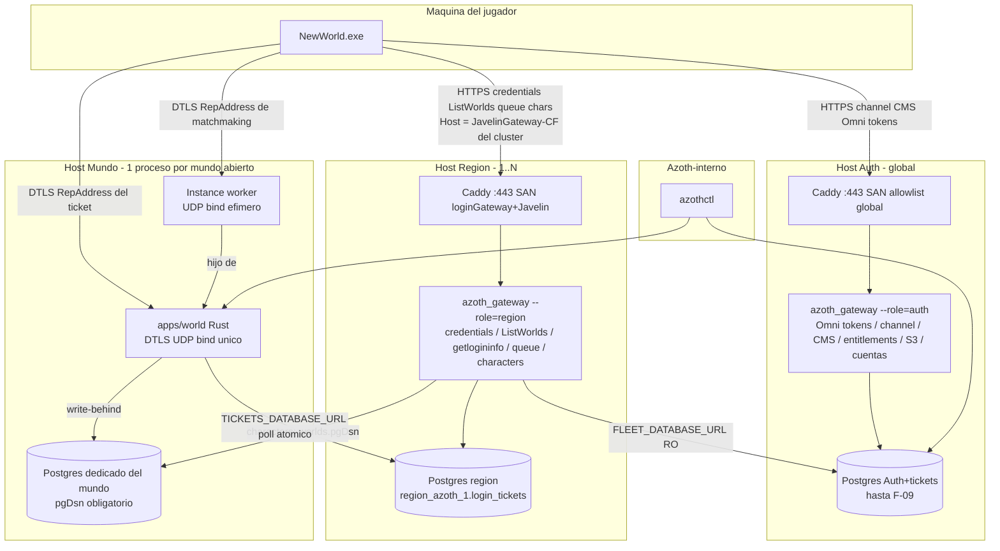
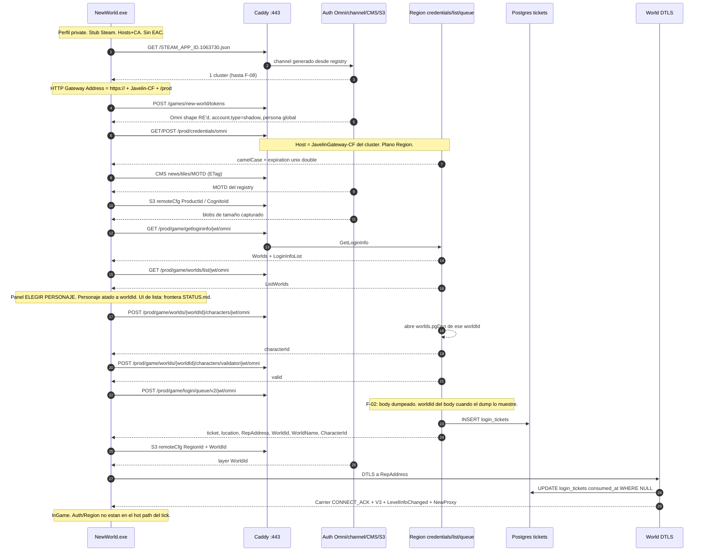
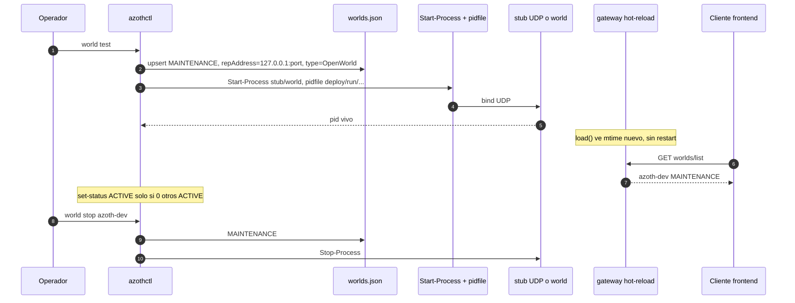
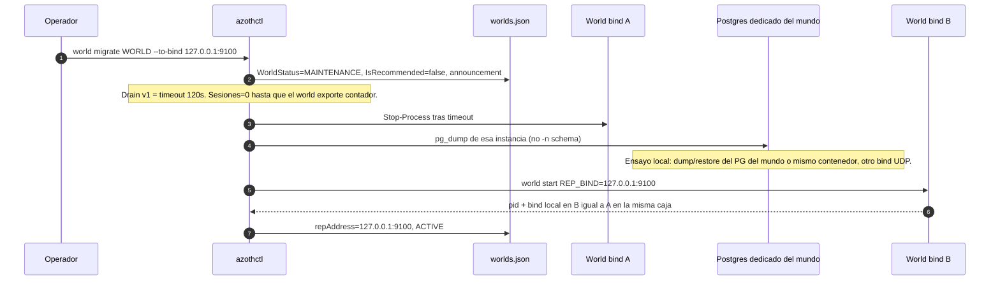

# [ARCHIVED — pre-monorepo design document (Spanish)]

> Written 2026-09-06 for the three-submodule layout (research/emulator/launcher).
> The repo is now a single monorepo: research/ and services/{gateway,world,launcher} + deploy/.
> Kept for design rationale; paths inside refer to the OLD layout and do NOT resolve.
> Live architecture docs: [docs/INDEX.md](../INDEX.md) and [services/docs/](../../services/docs/INDEX.md).

---

# Azoth — Arquitectura de flota: Auth global, Regiones, Mundos

| Campo | Valor |
| --- | --- |
| **Título** | Contrato de topología de producción: Auth · Región · Mundo · Instancia |
| **Autor** | operador del repo |
| **Fecha** | 2026-09-11 |
| **Estado** | Draft (rev. 5) |
| **Repo** | `C:\Users\ivang\Desktop\Dev\NewWorldPrivateServer` |
| **Relación** | Complementa `docs/ARQUITECTURA.md` (rev. 5). **No lo reemplaza.** El MVP de 2 procesos sigue vigente; este documento es el *target* al que crece. |
| **Cliente** | `[RETAIL].Javelin.1.400.6031.6004151` |
| **Marca** | Azoth. Mundo semilla `azoth-1` / worldId `00000000-0000-4000-8000-000000000001` / worldName `azoth-1-01-1` |

Este documento es un **contrato de implementación**. Describe cómo se ve Azoth cuando hay servidores de verdad: el cliente de New World recorre la misma escalera que recorrió en Amazon, y el operador levanta, apaga, prueba y migra regiones y mundos como unidades. No es el mock HTTPS del día 1.

---

## Overview

El cliente no conoce “un servidor Azoth”. Conoce un **channel** (directorio de clusters), un **Omni global** (`tokenservice.amazongames.com`), un **HTTP Gateway** por cluster (`https://` + JavelinGateway-CF + `/prod`, esquema hardcodeado) y un **`RepAddress` UDP** por mundo. Esa escalera es el producto visible. Azoth la reproduce con cuatro planos de runtime más un plano de control que el cliente nunca llama.

Hoy el repo ya tiene el embrión: un proceso Python (`emulator/apps/gateway/src/azoth_gateway/`) sirve Omni + CMS + channel + ListWorlds + getlogininfo + queue + credentials; `data/worlds.json` ya declara `regions[]` + `worlds[]`; `routes/registry.py` es la fuente de verdad con hot-reload por mtime. `apps/world/src/` no tiene fuentes (Fase 2 del MVP). Este documento fija cómo ese único proceso y ese JSON crecen a N mundos, luego N regiones, luego hosts remotos, **sin** clonar 4 REPs + 7 hubs + DynamoDB.

Crecimiento incremental, no big-bang:

```
hoy     1 gateway Python :8080 + 1 mundo en worlds.json + Caddy :443
mañana  N mundos en la misma región (mismo proceso HTTP, N procesos world)
luego   N regiones in-process (channel emitido + filtro por Host)
después 2º host (mismo binario --role=region; Caddy propio; CA Azoth reusada)
```

---

## Relación con el MVP (no se tira)

`docs/ARQUITECTURA.md` (rev. 5) es el contrato del **día 1**:

- 2 procesos de aplicación: gateway Python `:8080` + world Rust DTLS.
- Caddy termina TLS en `:443`.
- Postgres entra en el PR de characters, no antes.
- Tick 30 Hz, un hilo de sim, write-behind, el tick **nunca** espera a SQL.
- Un mundo abierto = **un proceso de sim** hasta medir un techo real.
- Instancias (expedición/OPR) sí son otros procesos.
- No clonar 4 REPs + 7 hubs espaciales + DynamoDB en el tick + Lambda por microservicio.

Todo eso **sigue vigente**. Este documento no reabre esas decisiones. Añade la topología de *producto* (auth / región / mundo) y el plano de control del operador. El rollout de flota **empieza desde el estado actual del repo**, no desde PR-01 de layout. El primer extra HTTP process es F-09 (`--role=region` en un segundo host). Hasta F-08 el recuento de procesos de aplicación sigue siendo 2 (gateway + world).

Correcciones de hecho respecto al doc MVP (el código vivo gana; no reescribimos `ARQUITECTURA.md` aquí):

| Tema | `ARQUITECTURA.md` (rev. 5) | Código / `STATUS.md` 2026-09-11 |
| --- | --- | --- |
| `account.type` | `"full"` para no empujar al link Amazon | El cliente aceptó **`"shadow"`** (`routes/omni.py`). `full` no se ha verificado en vivo. |
| Credentials | STS PascalCase, `Expiration` ISO | camelCase `accessKeyId/secretAccessKey/sessionToken/expiration` (**double unix**, no ISO). ISO crasheaba en `+0x7465476`. |
| Channel | “URL parcheada vs hosts+CA” abierto | Cerrado: esquema `https://` hardcodeado → **hosts+CA, Caddy :443 se queda**. |
| ListWorlds | no existía como ruta nombrada | `/prod/game/worlds/list/jwt/omni` (tabla `.rdata` @`0x84ff388`). |
| Host de credentials | listado junto a Omni | Live: `https://d1w0bfy6smo4d1.cloudfront.net/prod/credentials/omni` = **JavelinGateway-CF del cluster** (`client_expect.json`). Plano Región, no Auth. |

F-04 (Postgres) **sí** actualiza `emulator/docs/DATA.md` en el mismo PR. No toca `docs/ARQUITECTURA.md`.

---

## Background & Motivation

Amazon operaba New World como producto regional: el jugador elegía `EU Central` / `US East` / etc. en el dropdown, veía mundos (`live-1-12-2`), creaba un personaje **atado a un mundo**, hacía cola y aterrizaba en un `RepAddress` efímero. Internamente eso era 4 REPs públicos, 7 hubs EC2 con handoff de actor en fronteras de celda, instance pool, DynamoDB ~800k writes/30s (re:Invent 2021). Ese infierno interno **laggeó** con menos gente de la que el design sheet prometía — sobre todo en ciudades, por densidad, no por CCU global (`emulator/docs/PERFORMANCE.md`).

Azoth quiere el **producto visible**, no la planta interna:

1. Un **servidor principal** = auth / gateway. Deja loguear o no, crea cuentas, Omni, CMS, channel.
2. **Regiones** (como `fra-prod` / `iad-prod`). Fáciles de levantar.
3. Cada región tiene **mundos** = servers donde la gente tiene personajes. Fáciles de levantar, probar, apagar, migrar a otra máquina.
4. Topología derivada de lo que **ya sabemos del juego**, no de un MMO genérico.

Dolor actual si no fijamos esto ahora:

- `worlds.json` ya tiene `regions[]` + `worlds[]`, pero el channel (`channel-azoth.json`) es un cluster hardcodeado cuyos `publicApis` siguen siendo hostnames de Amazon (redirigidos por hosts). No hay contrato de “añadir una región”.
- `queue.py` emite el ticket del **primer** mundo ACTIVE, no del `worldId` que eligió el jugador. Fallback a `worlds[0]` incluso en MAINTENANCE (`test_registry_override_hot_reload` lo exige hoy).
- `characters.py` sirve un placeholder global, no personajes `UNIQUE (world_id, name)`.
- No hay Postgres. No hay CLI de operador. No hay protocolo de drain/migrate.
- El modelo del cliente **deserializa** `TransferToRegion`, `PendingWorldMerges`, `RecommendedTransferWorldId`, `AllowQueueTransfer` (claves en `.rdata` / `enums.json`). **No** hay evidencia de que la UI las pinte: `STATUS.md` 2026-09-11, ListWorlds 200 y la lista sigue vacía; aws-sdk ignora claves que no matchean, sin error. Un migrate de Azoth debe *emitir* esas claves, no venderse como UX verificada.
- Si mañana se “inventa Kubernetes + 7 hubs” para parecer Amazon, repetimos el fallo de densidad que `PERFORMANCE.md` prohíbe.

---

## Goals & Non-Goals

### Goals

- El cliente 1.400 recorre la misma escalera `GameConnection` contra Azoth que contra Amazon, eligiendo cluster del channel y mundo de `ListWorlds`.
- Auth es un singleton global (Omni tokens + channel + CMS + entitlements + cuentas + S3 remoteCfg).
- Región = unidad de HTTP de juego: **credentials/omni**, ListWorlds, getlogininfo, queue, CRUD de personajes de esa región. Mismo Host que el JavelinGateway-CF del cluster.
- Mundo = unidad de persistencia de personaje + **un** proceso de sim DTLS. Migrar mundo = mover proceso + snapshot + actualizar `RepAddress` en el registry.
- Instancias (expedición/OPR) = procesos efímeros, otro `RepAddress`, hijo del mundo.
- Operador levanta/apaga/prueba/migra regiones y mundos con `azothctl` + registry. Sin orquestador. Supervisor Windows = `Start-Process` + pidfile (no systemd, no Kubernetes).
- Channel **generado** a partir de regiones vivas. Hoy el JSON es estático; el target es emitirlo. Un segundo cluster **no** se sirve al cliente hasta que ListWorlds filtre por Host (F-08).
- Rollout incremental desde el repo actual. Primer PR de flota = modelo de registry + CLI mínimo, **sin** partir el proceso gateway.

### Non-Goals (siguen vigentes + específicos de flota)

- No clonar 4 REPs + 7 hubs + DynamoDB en el tick + Lambda por microservicio.
- No partir un mundo abierto en N cajas con handoff de actor en fronteras de celda. Un mundo = un proceso de sim hasta medir un techo real.
- No Kubernetes, no service mesh, no “region sim”, no systemd (el operador es Windows).
- No anycast / múltiples binds UDP por mundo. Un mundo, un bind.
- No zero-downtime heroico en migrate. Objetivo: minutos, **ensayo local de puerto/schema primero**; caja remota es runbook aparte cuando exista transporte.
- No voz Vivox funcional (stub o ignorar).
- No reescribir `docs/ARQUITECTURA.md` ni reabrir los PR del MVP (layout, skip-EAC, pin DTLS).
- No inventar paths HTTP que no estén en el exe / `STATUS.md` / `research/derived/routes.json`. Paths de control = Azoth-interno, loopback, nunca :443.
- No auth Steam real en private. Stub local (`launcher/steam_stub/`).
- El plano de control **no** es un API que el cliente llama.
- No congelar el wire de `WorldType` a `eWorldType_*`. Esos son labels de reflexión UI; el seed y el mapper RE'd usan `OpenWorld` / `FTUE`.
- No afirmar que la UI de lista/merge/transfer ya pinta. Frontera en `STATUS.md`.

---

## Hechos del juego que anclan el diseño

Citas concretas. Si un hecho nuevo del cliente contradice este doc, gana el cliente.

### Channel = directorio de regiones

Fuente: `research/notes/channel_config.json`. Mock actual: `emulator/apps/gateway/src/azoth_gateway/data/channel-azoth.json`. El cliente elige un cluster; construye:

```
ClusterId            <- clave del channel (oficial: fra-prod; Azoth hoy: azoth-1)
Gateway Signing Host <- publicApis[loginGateway].apiEndpoint
Gateway Address      <- publicApis[JavelinGatewayService-CF].apiEndpoint
HTTP Gateway Address <- "https://" + Gateway Address + "/prod"   ← esquema HARDCODEADO
```

Clusters oficiales:

| Cluster | Display | loginGateway AWS region | authStack hostname |
| --- | --- | --- | --- |
| `fra-prod` | EU Central | eu-central-1 | `2mfrik7h83.execute-api.us-east-1.amazonaws.com` |
| `gru-prod` | SA East | sa-east-1 | `kqqt5twsi7.execute-api.us-east-1.amazonaws.com` |
| `iad-prod` | US East | us-east-1 | `eudbjx6mig.execute-api.us-east-1.amazonaws.com` (**no** está en la allowlist hoy) |
| `pdx-prod` | US West | us-west-2 | `q8hqllbg6k.execute-api.us-east-1.amazonaws.com` |
| `syd-prod` | AP Southeast | ap-southeast-2 | `hhf8nn71vb.execute-api.us-east-1.amazonaws.com` |

Cada cluster tiene `publicApis[]` con `clientTag`: `authStack`, `loginGateway`, `JavelinGatewayServiceV2`, `JavelinGatewayService-CF`. El **orden no es estable**: fra-prod lista authStack primero; iad-prod lista loginGateway primero. Azoth **normaliza** al emitir: authStack, loginGateway, JavelinV2, Javelin-CF.

Omni es **global**: `platformMetadata.OMNI.STEAM_APP_ID.1063730.omniTokenUrl` = `https://tokenservice.amazongames.com`. CMS / entitlements / catalog / privacy / identity también son globales (`*.amazongames.com` / CloudFront CMS). S3 remote-config es por ProductId / RegionId / CognitoId / WorldId (`routes/s3.py`).

**Credentials no van a Omni ni al authStack.** Captura live (`client_expect.json`):

```
GET/POST https://d1w0bfy6smo4d1.cloudfront.net/prod/credentials/omni
```

Ese hostname es el `JavelinGatewayService-CF` de fra-prod = HTTP Gateway del **cluster elegido** = plano Región. `ARQUITECTURA.md` y `hosts-allowlist.json` (`role: gateway-cf-eu`) coinciden. Hoy el mismo proceso Python sirve path `/prod/credentials/omni` sin mirar Host (`app.py`), así que el bug de plano **solo explota en F-09**.

`routes/channel.py` hoy: sirve el JSON empaquetado y **solo overlay** `displayName`/`localizedName` desde el registry si el `region.id` coincide con una clave del channel. No emite clusters nuevos. Eso es exactamente lo que F-03 cambia.

Cada cluster oficial tiene su `poolId` (iad ≠ fra). Azoth **no** copia el poolId de iad: un solo `poolId` (el de `azoth-1` / fra, `us-east-1:0de93f7c-814e-4d48-a8fd-b6efc2f9ed93`) en todos los clusters emitidos, para no multiplicar keys S3 `CognitoId/`. `RegionId` S3 = `region.id` del registry. `s3.py` matchea por substring y sirve padding de tamaño, así que un RegionId nuevo no 404-ea; el knob es el channel.

### Mundos = unidad de personaje + simulación

Registro vivo, literal `emulator/apps/gateway/src/azoth_gateway/data/worlds.json`:

```json
{
  "regions": [
    {
      "id": "azoth-1",
      "displayName": "Azoth-1",
      "awsRegion": "us-east-1",
      "status": "ACTIVE"
    }
  ],
  "worlds": [
    {
      "id": "00000000-0000-4000-8000-000000000001",
      "name": "azoth-1-01-1",
      "regionId": "azoth-1",
      "displayName": "Azoth-1",
      "worldSet": "azoth-1-01",
      "status": "ACTIVE",
      "type": "OpenWorld",
      "maxPlayers": 2500,
      "repAddress": "127.0.0.1:9000",
      "announcement": "",
      "version": "1.0.0"
    }
  ]
}
```

`type` en el seed es **`OpenWorld`**, no `eWorldType_OpenWorld`. `registry.py` (mapper VA `0x1417c4000`) referencia exactamente `"FTUE"` y `"OpenWorld"` — tokens planos. `eWorldType_*` viven en el descriptor UI (`0x1483c0900`) como **labels de reflexión**, no como wire. F-01 no debe exigir `eWorldType_*` en el schema. El override del test `test_registry_override_hot_reload` todavía manda `eWorldType_OpenWorld`; es deuda del test, no del seed.

Nota: `AZOTH_WORLD_NAME` en `registry.py` es `"azoth-1"` (fallback si el JSON no trae `name`). El mundo real se llama `azoth-1-01-1`. El fallback solo se usa con registry vacío/roto.

El naming copia el oficial (`live-1-12-2` en worldSet `live-1-12`, sesión `research/sessions/live_20260906_160330`). `routes/registry.py` es source of truth de getlogininfo / worlds_list / motd / queue, hot-reload por mtime. Override `mock_discovery/worlds.json` gana sin reiniciar el gateway. JSON a medio escribir: se conserva el último doc bueno.

Shape `ListWorldsResponseBody` (RE, `.rdata` ~`0x8702000`): `Worlds`, `RecommendedWorlds`, `PendingWorldMerges`; por mundo `PublicName`, `PublicStatusCode`, `WorldName`, `WorldStatus`, `WorldType`, `WorldVersion`, `QueueWaitTimeSec`, `WorldAgeDays`, `WorldPopulationStatus`, `IsFull`, `IsRecommended`, `MaxConnectionCount`, `TransferToRegion`. UI camelCase (`worldSet`, `maxAccountCharacters=4`, `queueSize`). Wire de tipo: `FTUE` / `OpenWorld` (y lo que el mapper acepte; `Unknown` es label UI). Status que ya servimos: `ACTIVE` / `MAINTENANCE`.

Código real de emisión hoy:

- `worlds_list_doc`: `Worlds`, `RecommendedWorlds`, `PendingWorldMerges` (listas vacías las dos últimas).
- `getlogininfo_doc`: lo anterior más `LoginInfoList`, `AccountIsLocked`, `AllowQueueTransfer`, `QueueName`.
- **No** se emiten hoy `RecommendedTransferWorldId` ni `RecommendationType`. `_world_entry` sí emite `TransferToRegion: ""`.

Paths REST (tabla exe @`0x84ff388`, `research/derived/routes.json`, `STATUS.md`). El cliente pide `/prod` + path. **No inventar otros:**

| Operación (aws-sdk) | Path |
| --- | --- |
| `GetLoginInfo` | `/prod/game/getlogininfo/jwt/omni` |
| `ListWorlds` | `/prod/game/worlds/list/jwt/omni` |
| `PostGameWorldsWorldIdCharacters` | `/prod/game/worlds/%s/characters/jwt/omni` |
| `PatchCharacter` | `/prod/game/characters/%s/jwt/omni` |
| `QueueLogin` | `/prod/game/login/queue/v2/jwt/omni` |
| `RefreshQueuedLogin` | `/prod/game/login/queue/v2/%s/jwt/omni` |
| `ValidateCharacter` | `/prod/game/worlds/%s/characters/validator/jwt/omni` |
| `LinkIdentity` | `/prod/game/linkIdentity` |
| `UnlinkIdentity` | `/prod/game/unlinkIdentity` |

También existen variantes sin `/jwt/omni` y sin `/jwt` (misma tabla). El gateway ya matchea por substring. Content-Type de ListWorlds/getlogininfo: `application/x-amz-json-1.1`.

Personajes: atados a `world_id`. `maxAccountCharacters=4` por mundo en el descriptor UI. Típico: 1 personaje por mundo, no un personaje que viaja entre mundos sin transfer. Error RE'd para el techo: `TOO_MANY_CHARACTERS_FOR_WORLD` (`models.json`, token en un enum concatenado — **no** es una respuesta REST capturada). Mundo en mantenimiento: token `MAINTENANCE_MODE` en el mismo enum. El shape HTTP de esos errores **no está capturado**; F-02 fija un contrato de trabajo (abajo) y lo itera con dumps.

Queue (campos que el cliente **consumió** en Game.log; body TLS en official): ticket `worldId_uuid`, `location` `""` \| `@mm_loginservices_location_FTUE000`, `RepAddress` ip:port, `WorldId`, `WorldName`, `CharacterId`. El bind UDP vive en `worlds.repAddress`, **no** duplicado como campo extra del ticket. Consume atómico en Postgres cuando exista (`ARQUITECTURA.md`):

```sql
UPDATE login_tickets
   SET consumed_at = now()
 WHERE ticket_id = $1
   AND consumed_at IS NULL
   AND expires_at > now()
 RETURNING *;
```

Hoy `queue.py` no persiste y **ignora el request**: `queue_fields(load())` = primer ACTIVE, fallback a `worlds[0]` si todos están MAINTENANCE. `Handler.do_POST` lee el body para tokens/credentials, luego llama `_try_game_mocks()` **sin pasarle el body**; el dump de queue es headers-only. `LoginQueueRequest` en `models.json` no lista un campo `WorldId` claro (nearby keys mezcladas con ListWorlds). F-02 tiene que (1) pasar el body, (2) dumpearlo, (3) parsear `WorldId`/`worldId` cuando el dump lo muestre. Hasta entonces: **≤1 mundo ACTIVE** en runtime; N ACTIVE sin id en body → `400` + dump, sin ticket. F-05 no deja un segundo ACTIVE.

### Señal de migración en el modelo del cliente (no en la UI todavía)

Campos RE'd (`research/derived/enums.json` / `models.json`):

- Por mundo: `TransferToRegion` = **cluster id** del channel (decidido: `iad-prod`). F-07b lo emite. UI no verificada.
- Por respuesta ListWorlds/GetLoginInfo: `PendingWorldMerges`, `RecommendedWorlds`.
- `PendingWorldMerge` (gRPC/modelo): `sourceWorldId`, `targetWorldId`, `scheduledDate`.
- En el cluster de ListWorldsResponseBody, **no emitidos hoy**: `RecommendedTransferWorldId`, `RecommendationType`.
- `getlogininfo_doc` sí emite `AllowQueueTransfer` (false) y `QueueName` ("").

Amazon fusionaba/trasladaba mundos. El cliente **tiene parser** para esas claves. `STATUS.md`: consume ListWorlds 200 y **la lista sigue vacía**. aws-sdk ignora claves desconocidas sin error. Un migrate de Azoth **emite** este idioma. No prometemos que el frontend pinte banner de transfer hasta que pinte un mundo ACTIVE.

### Instancias ≠ mundos

`research/derived/grpc.json` `StubbedMatchmakingService`: `JoinQueue`, `PollForMatchSpawn`, `CleanupWorld`, `AcceptMatch`, `AbandonMatch`, `LeaveQueue`, `GetMatch`, `UpdateMatchStatus`, `ConfigureBackfill`, `DebugStartMatch`, `NotifyLeftGroup`.

Expediciones/OPR son **sesiones** con otro `RepAddress` y `LevelInfoChanged` a otro PAK (`levels/nw_dungeon_*`, `nw_opr_*`, …). `PERFORMANCE.md`: “Instances are other processes. A dungeon must not steal open-world tick time.” Amazon interno de UN mundo (4 REPs + 7 hubs) **no** es blueprint de flota.

FTUE: el ticket lleva `location: @mm_loginservices_location_FTUE000` y el mismo world process hace `LevelInfoChanged` → `FTUE_V2` / `FTUE_V2_CC`. No es un mundo aparte salvo que registremos uno `type=FTUE`. Azoth v1: FTUE = location en el mundo OpenWorld elegido.

### Login ladder (`GameConnection`)

Fuente: `research/docs/CONTRATO_CLIENTE.md`, captura `live_20260906_160330`.

```
Disconnected
  → QueryGameUpdateCheck
  → QueueGameLogin
  → WaitingForQueuedLogin            # HTTP login/queue/v2 → ticket + RepAddress
  → QueryForRemoteConfigClass
  → WaitingForRemoteConfigClass      # S3 configuration-sets (ProductId/RegionId/CognitoId/WorldId)
  → ObtainREPRequirements
  → StartREPConnection
  → WaitingForREPConnection          # DTLS + V3 Registration. Oficial tira a ~30 s
  → WaitingForActorGameConnection
  → WaitingForSpawnPoint
  → WaitingForPlayerSpawn            # LevelInfoChanged, carga PAK local
  → InGame
```

Cambio de mapa (shrine, expedición): `InGame → WaitingForPlayerSpawn` (~4 s). Cambio de **mundo**: `InGame → Disconnected` (vuelve al frontend). Eso importa para migrate: el jugador no “se teletransporta de host”; sale a Disconnected y vuelve a elegir / hace queue.

### Auth real ya descubierto

Omni tokens (`routes/omni.py`, parser `ags_fed_acc_token.cpp`): claves `region, limitedUseToken, platformAccount, account, isNewAccount, conflictingAccount, accessToken, expiresIn, fallbackToken`. `account.type` que el cliente aceptó: **`"shadow"`**. Persona `amzn1.developerPersonaId.…`. JWT `alg:"none"`, `iat`/`exp` en **milisegundos**. `expiresIn`: 7200 s. Host: `tokenservice.amazongames.com` (Auth).

Credentials (`routes/credentials.py`): `accessKeyId, secretAccessKey, sessionToken, expiration` (double unix), `region`. Refresh observado ~55 min en análisis previo. Host: **JavelinGateway-CF del cluster** (Región).

Steam: stub `launcher/steam_stub/`. Private no usa Steam de verdad. EAC no arranca. Hosts+CA.

### Local-dev stubs del propio juego

`client-connection.enable-local-dev` levanta in-process: Gateway, Character, Guild, Inventory, GroupFinder, Matchmaking, Notification, Achievement, Leaderboard, FCS, Privacy. Sirve para saber qué **no** hace falta en el Auth global el día 1 de flota: guild/inventory/matchmaking/leaderboard viven en mundo o en instancia, no en Omni.

### Performance (techo de un mundo)

Tick 30 Hz, un hilo de sim, sin GC. Fase 4: 200 jugadores en una celda, p99 < 16 ms. Un proceso: 1500–2500 CCU si AOI aguanta. Más CCU = más procesos (instancias o más mundos), no un tick más gordo. Más jugadores juntos en un sitio = el KPI que importa, no el CCU global.

---

## Proposed Design

### Cuatro planos de runtime + uno de control

Mapeo 1:1 con lo que el cliente ya entiende. El plano de control es **Azoth-interno**.

```
Plano Auth (global, 1):     Omni tokens + channel + CMS + entitlements + cuentas + S3 remoteCfg
Plano Región (N):           credentials/omni + loginGateway + ListWorlds + getlogininfo + queue + CRUD personajes
Plano Mundo (M por región): proceso world DTLS+sim + datos del shard (chars, inventario, world_state)
Plano Instancia (efímero):  dungeon/OPR, hijo del mundo, otro RepAddress
Plano Control (operador):   azothctl + registry. No lo llama el cliente.
```

Hoy Auth y Región son el **mismo proceso**. El split de Host/role solo es real en F-09.



**Colocation F-01..F-08:** un Caddy, un Python `--role=all`, un host, allowlist → `127.0.0.1`. El diagrama es el *target* cuando Auth vive en una caja **sin** Javelin-CF. En F-09, si azoth-1 sigue en IP_A, esa caja es `--role=all`, no `--role=auth`.

### Key Decision 4 en una frase

El gateway Python de hoy **ES** el Auth y **hospeda 1 región** (incluye `/prod/credentials/omni`). Split de proceso región solo cuando haya 2+ regiones en hosts distintos. Hasta entonces: un proceso, `worlds.json` con N mundos, channel con 1 cluster servido al cliente.

### Qué vive en cada plano

#### Plano Auth (global, singleton)

Proceso: `azoth_gateway --role=all` hoy y en F-09 mientras esa caja sirva algún Javelin-CF. `--role=auth` **solo** si la caja no termina ningún hostname de juego (credentials/ListWorlds). Hostnames de la allowlist que **quedan en el Caddy de IP_A** tras F-09:

| Host | Rol | Módulo hoy |
| --- | --- | --- |
| `d2c74t4zimux3r.cloudfront.net` | channel | `routes/channel.py` |
| `tokenservice.amazongames.com` | Omni tokens `POST /games/new-world/tokens` | `routes/omni.py` |
| `2mfrik7h83.execute-api.us-east-1.amazonaws.com` | authStack (channel; **no** credentials) | allowlist; path de tokens si el cliente pega aquí |
| `d1hkbwzm1bktgo.cloudfront.net` | CMS news/tiles/MOTD | `cms.py` + `registry.motd_body` |
| `client.content-service.amazongames.com` | imágenes CMS `.dds` | `images.py` |
| `client.entitlementservice.amazongames.com` | entitlements | `entitlements.py` |
| `client.catalogservice.amazongames.com` | catalog | stub discovery |
| `client.agsprivacysettingsservice.amazongames.com` | privacy | stub |
| `prod.identity-service.amazongames.com` | identity | stub |
| `ags-javelin-remote-config.s3.amazonaws.com` | remoteCfg | `s3.py` |

Omni **no se autentica en la región**. Channel lista N clusters; `tokenservice` es uno. `authStack` de **todas** las regiones emitidas se **reescribe** al hostname Auth global (`2mfrik7h83…`), aunque `--from-official-cluster iad-prod` copie el resto de `publicApis` de iad. Si no, el cliente de iad pegaría a `eudbjx6mig…` (fuera de allowlist) y saldría de nuestro Omni.

Channel **generado** (target): Auth lee el registry y emite el JSON. `platformMetadata.OMNI` sigue fijo. Cada región `ACTIVE` o `MAINTENANCE` aporta su bloque `publicApis`. `OFFLINE` (Azoth-interno) se omite. **Gate F-03:** el channel *servido al cliente* emite un solo cluster (el primero ACTIVE) hasta F-08; los tests pueden construir un doc de 2 clusters sin servirlo.

S3 remoteCfg: hostname global (Auth). Keys `RegionId/<region.id>` y `WorldId/<uuid>`. Un `poolId` único (azoth-1) en todos los clusters.

Cuentas: persona Omni, TOS (endpoint aún no RE'd), entitlements. **No** personajes. **No** credentials.

Health: `GET /healthz` y `GET /metrics` ya existen (`routes/health.py`). Azoth-interno. `cms_missing_etag` está **hardcodeado a 0**; no es un contador real — no alertar sobre él hasta que se instrumente.

#### Plano Región (N)

Unidad de HTTP de juego. **No hay simulación de región.** El cliente, tras elegir cluster, pega a `HTTP Gateway Address` (Javelin-CF) y al `loginGateway`.

| clientTag | Host fra-prod (allowlist actual) | Paths |
| --- | --- | --- |
| `loginGateway` | `u433g9r00c.execute-api.eu-central-1.amazonaws.com` | juego (signing host) |
| `JavelinGatewayServiceV2` | `8otrnl8e8d.execute-api.eu-central-1.amazonaws.com` | stub |
| `JavelinGatewayService-CF` | `d1w0bfy6smo4d1.cloudfront.net` | **credentials/omni**, ListWorlds, getlogininfo, queue, characters |

`--role=region` **sí** sirve `/prod/credentials/omni`. `--role=auth` no. Por eso IP_A con `d1w0bfy6smo4d1` colocalizado corre `--role=all`: si fuera `--role=auth`, el CF de azoth-1 404-ea credentials y nadie entra a la región 1. El test unitario «role=auth → credentials 404» es válido; el runbook de 2 hosts no usa `--role=auth` en IP_A.

Cuando haya una **segunda región en otro host**, esa región necesita **otros** hostnames en el channel. Elegido: reusar hostnames oficiales de otro cluster (`iad-prod`: CF `d2oeuvxi3kfsrw.cloudfront.net`, loginGateway `0prplal5u1.execute-api.us-east-1.amazonaws.com`, JavelinV2 `3khxmonavl.execute-api.us-east-1.amazonaws.com`) y añadirlos a la allowlist + SAN. Inventar hostnames Azoth queda para más tarde.

ListWorlds de una región **solo** devuelve mundos con `regionId` de esa región. Hoy el registry no filtra. El filtro entra en F-08; hasta entonces el channel servido no lista un segundo cluster.

Tickets: `region_azoth_1.login_tickets` en el **PG Auth** hasta F-09 (mismo `DATABASE_URL` del gateway). El world los consume vía `TICKETS_DATABASE_URL` (**requerido**; día 1 = DSN Auth). No HTTP. F-09: siguen en Auth por defecto (DSN remoto); `postgres-region` solo si duele.

CRUD personajes: HTTP en la región, persistencia en el **PG dedicado del mundo**. `worlds.pgDsn` es **obligatorio desde F-04**, nunca null. La región abre ese DSN en cada `/worlds/{id}/characters`. Si el mundo está MAINTENANCE, create/validate responden 503 `MAINTENANCE_MODE`.

#### Plano Mundo (M por región)

Un mundo = un proceso `apps/world` (Rust, openssl DTLS, cipher `ECDHE-RSA-AES256-GCM-SHA384`) + los datos del shard. Hoy el árbol `apps/world/src/` está **vacío**: F-05 arranca un stub UDP, no el sim.

Env del proceso (Azoth-interno):

| Variable | Significado |
| --- | --- |
| `WORLD_ID` | UUID del registry |
| `REP_BIND` | `ip:port` UDP. Un solo bind. |
| `DATABASE_URL` | PG **dedicado** de este mundo (`worlds.pgDsn`). Nunca el PG Auth. |
| `TICKETS_DATABASE_URL` | **Requerido.** Día 1 = DSN del PG Auth (tickets). |
| `WORLD_NAME` | `azoth-1-01-1` |
| `GATEWAY_VERSION` | default `[RETAIL].Javelin.1.365.6031.6017213` |

Un mundo, un bind UDP. No 4 REPs.

Personajes, inventario, companies, war, world_state: **del mundo**. Migrar el mundo es migrar eso + el proceso.

`azoth-dev`: mundo de desarrollo. `azothctl world test` es **alias** de `world start` con defaults `127.0.0.1:<port>` y nombre `azoth-dev`. **Nace `MAINTENANCE`**: hasta que el dump de queue muestre `WorldId`, el runtime admite **como máximo 1 ACTIVE** (el semilla). Promover `azoth-dev` a ACTIVE exige `set-status` del otro a MAINTENANCE (el CLI rechaza un segundo ACTIVE). `world stop` → `MAINTENANCE`. No hay `world rm` en v1.

#### Plano Instancia (efímero)

Hijo del mundo. El operador no hace `azothctl instance add`. F-10, bloqueado por captura de expedición (ROADMAP #6). Hasta entonces el world abierto **no** corre dungeons en su tick.

#### Plano de control (Azoth-interno)

No Kubernetes. CLI + registry. Supervisor Windows: **`Start-Process` + pidfile** en `emulator/deploy/run/<worldId>.pid` (y `.log`). No systemd. `compose.yml` no existe hoy; F-04 lo añade para **Postgres** (`postgres-auth` + un `postgres-world-*` por mundo), no como orchestrator de mundos.

- Scripts: `emulator/deploy/azothctl.py` + wrapper `azothctl.ps1`.
- Fuente de verdad de `RepAddress` y `WorldStatus`:
  - **F-01..F-08:** `data/worlds.json` (hot-reload mtime). Un writer: el CLI (tmp+rename). El gateway **solo lee** JSON. F-04: `postgres-auth` = accounts+tickets; cada mundo su PG (`pgDsn`). ListWorlds no lee PG.
  - **F-09 (2º host):** SoT = `fleet.regions` / `fleet.worlds` en el PG del Auth. **Todos** los procesos que sirven ListWorlds / channel / MOTD leen `fleet.*` (incluido `--role=all` en IP_A). JSON deja de ser lector; el CLI **no** materializa cache JSON. Región remota: `FLEET_DATABASE_URL` RO.
- El gateway **no** arranca mundos.

Comandos por PR (inventario; no hay comandos huérfanos):

| Comando | PR | Qué hace |
| --- | --- | --- |
| `region ls` / `world ls` | F-01 | Lee registry |
| `world set-status <id\|name> ACTIVE\|MAINTENANCE` | F-01 | Escribe JSON atómico |
| `region add --from-official-cluster <id>` | F-08 | Registry only + allowlist hosts a 127.0.0.1. Reescribe authStack al global. Copia loginGateway / Javelin V2 / CF / displayName. **No** copia poolId (usa el de azoth-1). |
| `world start` / `world stop` / `world status` | F-05 | Start-Process + pidfile + set-status. Stub UDP mientras no haya world Rust |
| `world test` | F-05 | Alias de `start` localhost / `azoth-dev`, status **MAINTENANCE** (≤1 ACTIVE hasta dump de WorldId) |
| `world drain` | F-06 | set-status MAINTENANCE + espera `drain_timeout` (default 120 s). Sesiones=0 hasta que el world exporte contador |
| `world migrate --to-bind ip:port` | F-07 | **Local:** otro puerto y/o dump/restore del schema en el **mismo** PG. Flip `repAddress` |
| `world migrate --to-host` | F-07c | Runbook de caja remota. **No** se implementa hasta haber transporte (SSH/WinRM/agent) |

HTTP de control, si se añade más tarde: `127.0.0.1`, **no** :443, **no** allowlist. F-01 no lo necesita. **No** hay `GET /v1/tickets/next` en este contrato: el world poll-ea SQL.

---

## Secuencias

### Login: Omni global → región → mundo



### Spin-up de un mundo (test fácil)



Criterio F-05: ListWorlds/getlogininfo reflejan el status (test → MAINTENANCE). La cola por worldId es señal de F-02/F-06.

### Spin-up de una región nueva (F-08 in-process, F-09 otra caja)

F-08 (mismo host, mismo Caddy, mismo Python):

1. `azothctl region add --from-official-cluster iad-prod` escribe registry: copia loginGateway / Javelin V2 / CF / displayName / awsRegion; **reescribe authStack** a `2mfrik7h83…`; **poolId** = el de azoth-1.
2. Añade esos 3 hostnames de juego a `hosts-allowlist.json` con `ipv4: 127.0.0.1` (default).
3. `mint-cert.ps1` relee allowlist, reemite SAN, reload Caddy. `switch-mode.ps1 private` reescribe el bloque (sigue siendo loopback).
4. Flag de filtro por Host ON. Channel servido al cliente ahora lista 2 clusters.
5. GET worlds/list con `Host: d2oeuvxi3kfsrw.cloudfront.net` solo mundos `regionId=iad-prod`.

F-09 (segundo host) añade el contrato de IPs/CA/Caddyfile de la sección Caddy. No se hace en F-08.

### Migrate mundo — ensayo local (F-07)

Downtime objetivo: **minutos**. El cliente espera maintenance *si pinta status*; hoy puede no pintar nada. Emitimos MAINTENANCE igual.



Qué se **emite** al cliente (parser; UI no verificada):

| Caso | Campos | Qué no prometemos |
| --- | --- | --- |
| Mismo `worldId`, otro bind (F-07) | `MAINTENANCE` → `ACTIVE` + `RepAddress` nuevo | Que el frontend muestre un banner |
| Merge (F-07b) | `PendingWorldMerges[]` = `{sourceWorldId, targetWorldId, scheduledDate}` | UI de merge |
| Cambio de región (F-07b) | `TransferToRegion` = cluster id (`iad-prod`) | Que el frontend lo pinte |

Caja remota (F-07c): fuera de alcance hasta transporte. El título F-07 **no** es “host A → host B”.

Healthcheck F-07: el proceso local tiene pid vivo y `REP_BIND` en listening **en esa máquina** (netstat / intento de bind). No hay probe DTLS (pin = problema del MVP). No hay probe UDP desde otra caja.

---

## API / Interface Changes

### Cliente (no se inventan paths)

| Path | Plano | Hoy | Target flota |
| --- | --- | --- | --- |
| `GET …/STEAM_APP_ID.*.json` | Auth | JSON estático + overlay nombres | JSON **emitido**; 1 cluster al cliente hasta F-08 |
| `POST /games/new-world/tokens` | Auth | `omni.py` shadow | igual, cuentas en PG Auth |
| `/prod/credentials/omni` | **Región** (Host = Javelin-CF) | mismo proceso, camelCase unix | `--role=region` lo sirve; Auth F-09 **no** |
| CMS news/tiles | Auth | fixtures `research/schemas/live` | igual (ETag obligatorio) |
| CMS MOTD | Auth lee registry | `registry.motd_doc` | igual |
| S3 `configuration-sets/…` | Auth | tamaños capturados | `RegionId` = `region.id`; un `poolId` |
| `/prod/game/worlds/list/…` | Región | todos los mundos del JSON | filtrados por Host (F-08) |
| `/prod/game/getlogininfo/…` | Región | todos | filtrados por Host (F-08) |
| `/prod/game/worlds/%s/characters/…` | Región HTTP, datos Mundo | placeholder global | `worlds.pgDsn` |
| `/prod/game/login/queue/v2/…` | Región | primer ACTIVE + fallback MAINTENANCE | worldId del body cuando el dump lo muestre; 1 ACTIVE si no hay id; N ACTIVE sin id → 400; MAINTENANCE → 503 |
| DTLS `RepAddress` | Mundo | no hay proceso | 1 bind por mundo |
| Matchmaking gRPC stubbed | Instancia | no | F-10, tras captura expedición |

### Contrato de error de cola/chars (F-02, decidido)

**Decidido por el operador:** F-02 implementa este envelope. El dump del cliente puede corregirlo después, no se espera captura previa. Token `MAINTENANCE_MODE` en `models.json`.

```
HTTP 503
Content-Type: application/x-amz-json-1.1
{"errorCode":"MAINTENANCE_MODE"}
```

Mismo envelope para `TOO_MANY_CHARACTERS_FOR_WORLD` (400). N ACTIVE y body sin worldId (mientras el dump no muestre el campo):

```
HTTP 400
Content-Type: application/x-amz-json-1.1
{"errorCode":"INVALID_ARGUMENT"}
```

(el token está en el mismo enum concatenado; dump gitignored). Si el cliente no avanza, gana el dump + override.

### Azoth-interno (el cliente no lo llama)

Solo CLI en F-01..F-09. Si más adelante hay HTTP fleet: loopback, no Caddy :443. **No** se introduce `GET /v1/tickets/next` en F-09. Si el poll SQL cross-host duele, eso es un PR propio con contrato (un ticket, atómico, loopback, no :443), no un escape hatch.

### Registry — contrato de datos

Extiende el shape **real** de `worlds.json`. Campos nuevos opcionales (el gateway ignora claves de más).

```json
{
  "regions": [
    {
      "id": "azoth-1",
      "displayName": "Azoth-1",
      "awsRegion": "us-east-1",
      "status": "ACTIVE",
      "poolId": "us-east-1:0de93f7c-814e-4d48-a8fd-b6efc2f9ed93",
      "loginGatewayHost": "u433g9r00c.execute-api.eu-central-1.amazonaws.com",
      "javelinV2Host": "8otrnl8e8d.execute-api.eu-central-1.amazonaws.com",
      "javelinCfHost": "d1w0bfy6smo4d1.cloudfront.net",
      "authStackHost": "2mfrik7h83.execute-api.us-east-1.amazonaws.com"
    }
  ],
  "worlds": [
    {
      "id": "00000000-0000-4000-8000-000000000001",
      "name": "azoth-1-01-1",
      "regionId": "azoth-1",
      "displayName": "Azoth-1",
      "worldSet": "azoth-1-01",
      "status": "ACTIVE",
      "type": "OpenWorld",
      "maxPlayers": 2500,
      "repAddress": "127.0.0.1:9000",
      "announcement": "",
      "version": "1.0.0",
      "transferToRegion": "",
      "pgDsn": "postgresql://azoth@postgres-world-azoth-1-01-1:5432/azoth",
      "host": "localhost"
    }
  ],
  "pendingWorldMerges": []
}
```

Schema F-01: `type` enum de trabajo `OpenWorld` \| `FTUE` (strings del mapper). Aceptar también `eWorldType_*` en lectura (test viejo) y **normalizar a token plano** al emitir `WorldType`. No decidir el enum que pinta la lista — eso es `STATUS.md`.

`status` región: `ACTIVE` \| `MAINTENANCE` \| `OFFLINE` (OFFLINE = Azoth-interno). `status` mundo servido al cliente: `ACTIVE` \| `MAINTENANCE`. Mientras el bind no está up, el registry público dice MAINTENANCE.

`emit_channel` (F-03), con `.get()` y fallback a `channel-azoth.json`:

```python
AUTH_STACK_DEFAULT = "2mfrik7h83.execute-api.us-east-1.amazonaws.com"
AZOTH_POOL_ID = "us-east-1:0de93f7c-814e-4d48-a8fd-b6efc2f9ed93"

def emit_channel(reg: Registry, omni_meta: dict, serve_all: bool) -> dict:
    doc = {"channelName": "Azoth", "platformMetadata": omni_meta}
    regions = [r for r in reg.regions if r.get("status") != "OFFLINE"]
    if not serve_all:
        active = [r for r in regions if r.get("status") == "ACTIVE"]
        regions = (active[:1] or regions[:1])
    for r in regions:
        doc[r["id"]] = {
            "displayName": r.get("displayName", r["id"]),
            "localizedName": r.get("displayName", r["id"]),
            "poolId": AZOTH_POOL_ID,  # nunca el poolId de iad/gru/pdx/syd
            "publicApis": [
                {"awsRegion": "us-east-1", "version": "1.0",
                 "apiEndpoint": AUTH_STACK_DEFAULT,  # siempre el Auth global
                 "clientTag": "authStack", "stage": "prod"},
                {"awsRegion": r.get("awsRegion", "us-east-1"), "version": "1.0",
                 "apiEndpoint": r.get("loginGatewayHost") or FALLBACK_LOGIN,
                 "clientTag": "loginGateway", "stage": "prod"},
                {"awsRegion": r.get("awsRegion", "us-east-1"), "version": "1.0",
                 "apiEndpoint": r.get("javelinV2Host") or FALLBACK_V2,
                 "clientTag": "JavelinGatewayServiceV2", "stage": "prod"},
                {"awsRegion": r.get("awsRegion", "us-east-1"), "version": "1.0",
                 "apiEndpoint": r.get("javelinCfHost") or FALLBACK_CF,
                 "clientTag": "JavelinGatewayService-CF"},
            ],
        }
    return doc
```

Test F-03: dos regiones en el doc construido (no necesariamente servido) tienen el **mismo** `authStack` hostname. Fallback si faltan hosts: valores de `channel-azoth.json`. Sin `KeyError`.

---

## Data Model Changes

### Ownership

| Dato | Plano | Store tramo 1 (1 caja) | Store tramo 2 (2+ cajas, F-09) |
| --- | --- | --- | --- |
| Cuenta / persona Omni | Auth | PG `auth.accounts` | igual, PG Auth |
| `account.type` | Auth | `'shadow'` (seed; no `'full'` del SQL MVP) | igual |
| Steam identity stub | Auth | `steam_id_hash` nullable | igual |
| TOS | Auth | `tos_accepted_at` | igual |
| Entitlements / catalog / privacy | Auth | stub o PG Auth | igual |
| Channel JSON | Auth | emitido; SoT = JSON registry | emitido; SoT = `fleet.*` |
| CMS news/tiles | Auth | fixtures | igual |
| MOTD | Auth lee registry | JSON | `fleet.worlds` (mismo lector PG que ListWorlds) |
| remoteCfg | Auth | `s3.py` | igual |
| Lista mundos / RepAddress / status | Registry | **JSON** `worlds.json` (único lector gateway) | **PG `fleet.*`**: Auth, `--role=all` y región leen PG. JSON deja de leerse |
| Tickets de login | Región (store: PG Auth hasta F-09) | `region_azoth_1.login_tickets` en `postgres-auth` | world: `TICKETS_DATABASE_URL` = DSN Auth (red del operador en F-09) |
| Personaje | Mundo | PG dedicado (`worlds.pgDsn` **requerido**, nunca null) | región HTTP abre ese DSN. Migrate actualiza `pgDsn` si el PG se mueve |
| Inventario / world_state / companies / war | Mundo | mismo PG del mundo | igual |
| Matchmaking session | Instancia | efímero | igual |

### Nombres Postgres

Ident PG sin comillas **no puede llevar `-`**. Tickets/cuentas (PG Auth):

| Objeto | Ident |
| --- | --- |
| Región `azoth-1` (tickets) | schema `region_azoth_1` |
| Auth | schema `auth` |
| Fleet (F-09) | schema `fleet` |

Mundo: **instancia Postgres propia**, no schema en el PG Auth. Compose: servicio `postgres-world-azoth-1-01-1`, DB `azoth`. `worlds.pgDsn` apunta ahí. Migrate = `pg_dump` de esa instancia (no `-n`).

### FKs

Solo **intra-schema**. Se caen las FKs cross-plane del SQL MVP (`login_tickets.account_id REFERENCES accounts(id)`, `character_id REFERENCES characters(id)`). Integridad en aplicación: la región valida que `account_id` existe (lectura Auth o JWT persona) y que `character_id` existe en `worlds.pgDsn` antes de INSERT ticket. UUIDs se copian como valores, no como REFERENCES.

### Estrategia Postgres

**Tramo 1 (F-04, 1 máquina, 1 mundo):** **dos** contenedores Postgres, no Kubernetes. Compose:

- `postgres-auth` — cuentas + tickets (`auth.*`, `region_azoth_1.login_tickets`). Gateway Python: **`DATABASE_URL`** = este DSN.
- `postgres-world-azoth-1-01-1` — chars/inventario/world_state. Registry: **`worlds.pgDsn` requerido, nunca null.** World process: `DATABASE_URL` = ese DSN; `TICKETS_DATABASE_URL` = DSN Auth.

Registry ListWorlds **sigue en JSON**. Un writer CLI. Sin dual-write de dos lectores. Un segundo mundo (p.ej. `azoth-dev`) = **otro** servicio postgres en el mismo compose, no un schema extra.

**Tramo 2 (F-09):**

1. Registry = `fleet.*` en PG Auth. Todos los lectores ListWorlds/channel/MOTD usan `fleet.*`. JSON deja de leerse. `--role=all` en IP_A: `DATABASE_URL` = Auth+tickets.
2. Characters: región abre `worlds.pgDsn` (siempre el PG de ese mundo). Tras F-07c el CLI actualiza `pgDsn` **antes** del flip ACTIVE.
3. Tickets: world poll-ea `TICKETS_DATABASE_URL` (sigue siendo el PG Auth por defecto). No HTTP de tickets.

**El tick nunca espera a Postgres.** Write-behind.

F-04 seed: cuenta `AZOTH_PERSONA`, `account_type='shadow'` en Auth; `pgDsn` del semilla al contenedor mundo. Actualiza `emulator/docs/DATA.md` en el mismo PR.

---

## Caddy, hosts, certificados

Hecho cerrado (`STATUS.md`): esquema **`https://` hardcodeado**. Caddy :443 se queda. Python no bindea 443.

`emulator/deploy/Caddyfile.json` hoy: un server `:443` sin matcher de Host; todo → `127.0.0.1:8080`. Vale hasta F-08.

`emulator/deploy/switch-mode.ps1` hoy: **siempre** escribe `127.0.0.1` y `::1` para cada host `redirect`. No hay campo IP. F-08 sigue así (2ª región in-process). F-09 **sí toca** este script.

`emulator/deploy/mint-cert.ps1` hoy: firma `certs/leaf.crt` con `%APPDATA%\Caddy\pki\authorities\local\root.{crt,key}`. `Caddyfile.json` carga **ese** `leaf.crt`/`leaf.key`, no `azoth-leaf.pem`. `deploy/certs/azoth-ca.pem` es un leftover **trustme** (`O=trustme v1.2.1`, `OU=Testing CA #Qz27GNfvUZbGubHh`); `azoth-leaf.pem` está firmado por esa CA. No hay `azoth-ca-key` en el dir. **No** es la CA viva. Un segundo Caddy “como localhost” genera **otra** CA on-demand — eso es lo que F-09 evita.

| Pieza | TLS | Puerto |
| --- | --- | --- |
| Auth | Caddy :443, SAN allowlist global + clusters colocalizados | 443/tcp |
| Región mismo host (F-08) | el mismo Caddy | 443/tcp |
| Región otro host (F-09) | Caddy propio, SAN = 3 hostnames de juego de esa región | 443/tcp |
| Mundo | ningún HTTPS | UDP `REP_BIND` |
| Control | CLI; sin Caddy | — |

### Contrato mínimo F-09 (operable)

**(a) Allowlist con IP.** Cada entrada `redirect` gana `ipv4` opcional (default `127.0.0.1`) e `ipv6` **opcional, sin default**. `switch-mode.ps1` emite `::1` **solo** si `ipv6` está seteado. Si solo hay `ipv4` no-loopback, **una** línea IPv4 — Windows IPv6-first no debe mandar Omni ni iad-prod a localhost. Una allowlist no sirve dos públicos a la vez: LAN (amigos + 2 hosts) = **solo ipv4**; `ipv4: 127.0.0.1` + `ipv6: ::1` queda para el perfil «juego en la misma caja que Caddy». Test F-09 (allowlist LAN): ningún hostname contiene `::1`. Ejemplo LAN:

```
tokenservice.amazongames.com          → ipv4 IP_A
d2c74t4zimux3r.cloudfront.net         → ipv4 IP_A
d1w0bfy6smo4d1.cloudfront.net         → ipv4 IP_A   (región 1 colocalizada)
d2oeuvxi3kfsrw.cloudfront.net         → ipv4 IP_B
0prplal5u1.execute-api.us-east-1…    → ipv4 IP_B
3khxmonavl.execute-api.us-east-1…    → ipv4 IP_B
```

Cada cliente corre `switch-mode.ps1 private` **después**. Sigue siendo el toggle official/private.

**(b) Una sola CA Azoth = snapshot de la CA Caddy que ya firma `leaf.crt`.** F-09 copia `%APPDATA%\Caddy\pki\authorities\local\root.crt` + `root.key` a `deploy/certs/azoth-ca.pem` + `azoth-ca-key.pem` (**reemplaza** el PEM trustme; la key gitignored). `azoth-ca.pem` / `azoth-leaf.pem` actuales se documentan como **muertos**. `mint-cert.ps1` gana `-CaCrt`/`-CaKey`/`-Hosts`/`-OutDir` y, post-snapshot, firma ambos leafs con ese par — no con una CA on-demand nueva en la caja B. `Caddyfile.json` y `Caddyfile.region.json` cargan `leaf.crt`/`leaf.key` emitidos así. Clientes: Root = ese `azoth-ca.pem` (el snapshot Caddy, no trustme).

**(c) Plantilla `emulator/deploy/Caddyfile.region.json`.** Server `:443`, matcher de Host = los 3 hostnames de juego de esa región, upstream `127.0.0.1:8080` del `--role=region`. **No** enruta channel/Omni/CMS.

**Ensayo documentado F-09 (señal del PR):** IP_A `:443` **`--role=all`** (azoth-1 colocalizado; credentials de `d1w0bfy6smo4d1` tienen que vivir ahí) + IP_B `--role=region` + `Caddyfile.region.json`. `curl --resolve d2oeuvxi3kfsrw.cloudfront.net:443:<IP_B> …/prod/credentials/omni` → 200 camelCase. Channel al Caddy de IP_A → 200. Omni al Caddy región → no se sirve. `--role=auth` puro no se usa en este ensayo.

Mundos **no** se añaden al leaf cert.

---

## Modelo de identidad

```
Steam stub local (steam_api64.dll)
    → Omni tokenservice (Auth global)
        → persona amzn1.developerPersonaId.*
        → account.type = "shadow"
        → credentials camelCase, expiration unix   ← Host Javelin-CF (Región)
            → cluster elegido (channel)
                → personajes UNIQUE por mundo (max 4)
                    → ticket worldId_uuid
                        → V3 registration en ESE proceso world
```

- Persona global. Personaje por mundo.
- Private no usa Steam de verdad. Auth no llama a `api.steampowered.com`.
- LinkIdentity / UnlinkIdentity: no-op razonable en private.
- `maxAccountCharacters=4` se enforcea en la región al POST characters.

---

## Failure modes

El cliente InGame **no** reconsulta Omni cada frame. Hot path = DTLS. MOTD pollea ~60 s (CMS/Auth). getlogininfo pollea en el **frontend**, no InGame. Credentials viven en la **Región**.

### Auth caído

| Quién | Efecto |
| --- | --- |
| Frontend / login | Nadie entra. Channel, tokens, CMS, S3 fallan. |
| InGame | **Sigue tickeando** con el world. |
| MOTD InGame | Poll CMS ~60 s falla. No hay evidencia de kick. |
| Refresh credentials ~55 min | **No depende de Auth.** Va al Javelin-CF (Región). Auth caído no tumba ese refresh. |
| Cola nueva | Depende de la Región (hoy el mismo proceso: sí se cae). |

Auth no se replica activo-activo. Restart del Python: segundos.

### Región caída (Auth vivo — solo real tras F-09)

| Quién | Efecto |
| --- | --- |
| credentials / ListWorlds / getlogininfo / queue / characters | 5xx / timeout. Login no completa. Refresh credentials ~55 min **falla**. |
| Sesiones DTLS vivas | **Siguen.** Tickets ya consumidos irrelevantes. Tickets no consumidos quedan en PG región. |
| Instancia nueva | Falla. |

Hoy Auth=Región=un proceso, así que “región caída” = Auth caído. El split F-09 hace este modo real.

### Mundo caído

| Quién | Efecto |
| --- | --- |
| `WaitingForREPConnection` | Oficial tira a ~30 s. |
| InGame | Drop DTLS. |
| Frontend | Operador pone MAINTENANCE a mano (`world set-status` / `world status` mira pidfile). No hay watchdog k8s. |
| Datos | Write-behind: ≤ N s de posición. |

### Registry ilegible

`registry.py` conserva el último doc bueno. CLI escribe tmp+rename (F-01).

### Caddy caído

Nada de HTTPS. Mundos UDP independientes: InGame sigue.

---

## Alternatives Considered

### A1. Un microservicio por `clientTag` (rechazado)

El cliente ya habla con 4 hostnames que hoy aterrizan en un proceso. 4 servicios vacíos no descubren JSON. Planos lógicos, no procesos, hasta el 2º host.

### A2. Partir el mapa en hubs / celdas (rechazado hasta medir)

Handoff de actor = el lag de official (`PERFORMANCE.md`). Un mundo = un proceso de sim.

### A3. Kubernetes / Nomad (rechazado v1 flota)

El operador quiere `world start` / `world migrate` local. K8s no habla `PendingWorldMerges`. `azothctl` + Start-Process + pidfile.

### A4. Personaje global que entra a cualquier mundo (rechazado)

El cliente ata chars a `worldId`. Transfer = merge/región, no roaming.

### A5. PG dedicado por mundo desde F-04 (**elegido** por el operador)

Schema-por-mundo en un PG compartido queda rechazado. Cada mundo nace con su contenedor Postgres (`postgres-world-<name>`). Migrate = dump/restore de **esa** instancia. Día 1: `postgres-auth` (cuentas+tickets) + `postgres-world-azoth-1-01-1`. Compose, no Kubernetes.

### A6. 4 REPs delante de cada mundo (rechazado)

Un mundo, un bind UDP. Anycast = detalle de red futuro.

### A7. Personajes y/o tickets en el PG de región (rechazado para chars; aceptado para tickets)

| | Chars en región (como el SQL plano de `DATA.md`) | Chars en mundo (elegido) |
| --- | --- | --- |
| Pros | La fachada HTTP ya está en la región; un DSN; el MVP juntaba chars+tickets al gateway. | El PG del mundo **es** la unidad de migrate (`pg_dump` de la instancia). El personaje vive en el mundo (`/worlds/%s/characters`). |
| Cons | Migrar un mundo implica filtrar chars por `world_id` o dejarlos atrás. | La región abre `worlds.pgDsn` en cada CRUD desde F-04 (cross-DSN día 1, aceptado). |
| Veredicto | Tickets en el PG Auth hasta F-09. Chars en el PG dedicado del mundo. `pgDsn` obligatorio, nunca null. |

---

## Security & Privacy Considerations

Threat model: operador + amigos en LAN/VPN. El perfil official vs private de `ARQUITECTURA.md` **no cambia**.

| Amenaza | Sev. | Mitigación |
| --- | --- | --- |
| Plano de control en :443 | Alta | Solo CLI. Nada de fleet HTTP en allowlist. |
| Ticket reusado | Alta | Un uso, `consumed_at`, `expires_at`. |
| Mundo B lee schema de mundo A | Media | Role PG por schema. |
| Auth impersonation | Media | Private LAN. Tokens `alg:none` del mock. |
| Hosts sucio + official | Crítica | `switch-mode.ps1` intacto como toggle. F-09 le añade `ipv4` por host; **no** se deja de usarlo. Checklist: official restaura el bloque entero. |
| Segunda CA en host región | Alta (F-09) | Snapshot de la CA Caddy que ya firma `leaf.crt` (no el PEM trustme). |
| Región sirve Omni por hosts mal apuntado | Media | `Caddyfile.region.json` solo SAN de juego. |
| Snapshot pg_dump | Baja | Local, no git. |
| Tickets Steam en logs | Alta | No loguear `steam\|` / `ASIA`. Discovery gitignored. F-02 **sí** dumpea body de queue (gitignored). |

Auth no verifica SigV4. Egress a Amazon: cero.

---

## Observability

**Auth / Región**

- Ya: `GET /metrics` (`requests`, `by_route`, `unknown_paths`). `cms_missing_etag` es constante 0 — no usarlo como KPI hasta instrumentarlo.
- Añadir desde F-05: `worlds_active`, `worlds_maintenance`, `registry_mtime`. Desde F-02: `queue_tickets_issued`, `queue_tickets_rejected_maintenance`.
- Log JSONL: host, path, status, `world_id`. Bodies de queue a discovery gitignored, no al log info.

**World** (cuando exista el proceso Rust)

- `PERFORMANCE.md`: `tick_ms_p50/p99`, réplicas, bytes, actores, queue_depth.
- Flota: `world_id`, `rep_bind`, `sessions` (este contador es el que F-06 usará; hasta entonces drain = timeout).

**Control**

- `azothctl` imprime pasos. Log `emulator/deploy/run/*.log` gitignored.

**Carga (órdenes de magnitud)**

| | Target |
| --- | --- |
| Auth HTTPS | decenas de req/s en login; MOTD 1/60 s en frontend |
| Región HTTPS | credentials + ListWorlds poll + queue al click |
| UDP REP | ~100–200 pps/jugador |
| CCU por proceso mundo | 1 (Fase 2) → ~50 (Fase 4 MVP) → 200 apilados p99<16 ms |
| Downtime migrate local | minutos (drain 120 s + dump schema) |
| Postgres | write-behind; tick no espera |

---

## Rollout Plan

1. **Hoy (MVP):** 1 gateway + 1 mundo en `worlds.json`. Channel 1 cluster. Sin PG.
2. **F-01..F-03:** registry formal + CLI + queue/chars por worldId + channel emitido **de 1 cluster**. Mismo proceso.
3. **F-04:** `postgres-auth` + `postgres-world-azoth-1-01-1`. JSON sigue SoT de ListWorlds. `pgDsn` requerido.
4. **F-05..F-07:** Start-Process + pidfile, drain timeout, migrate **local** de puerto/schema. `azoth-dev`.
5. **F-07b:** emitter merge/TransferToRegion (campos, no UX).
6. **F-08:** 2ª región in-process, filtro Host, `region add`, allowlist loopback, channel de 2 clusters.
7. **F-09:** 2º host, IP_A `--role=all`, IPs en allowlist (sin `::1` fantasma), snapshot CA Caddy, `Caddyfile.region.json`, todos los lectores en `fleet.*`.
8. **F-07c:** runbook remoto cuando haya transporte (después de F-09).
9. **F-10:** instance workers. Bloqueado por ROADMAP #6.
10. **Rollback F-01..F-03:** revertir JSON. F-04+: `pg_dump` antes de migrate.

Flags **nuevos** (no existen `SERVE_CMS` / `SERVE_OMNI` en `config.py`; no citarlos como vivos):

| Flag | PR | Default |
| --- | --- | --- |
| `EMIT_CHANNEL_FROM_REGISTRY` | F-03 | on; el emitter limita a 1 cluster hasta F-08 |
| `FILTER_WORLDS_BY_HOST` | F-08 | on si `len(regions)>1` |
| `--role all\|auth\|region` | F-09 | `all` |

---

## Riesgos

| Riesgo | Sev. | Mitigación |
| --- | --- | --- |
| Enums `WorldType`/`WorldStatus` no pintan la lista | Alta (MVP) | Schema F-01 acepta `OpenWorld`/`FTUE`. No congelar `eWorldType_*`. Frontera = `STATUS.md`. |
| Body de queue sin `WorldId` | Alta | F-02 dumpea body. ≤1 ACTIVE en runtime. N ACTIVE sin id → 400. `azoth-dev` nace MAINTENANCE. |
| Shape `MAINTENANCE_MODE` incorrecto | Media | Contrato decidido: 503+`errorCode`. Dump puede corregir. |
| Split Auth/Región sin servir credentials | Crítica | KD + F-09: region sirve credentials. |
| Segunda CA | Alta | CA Azoth única. |
| `pg_dump` ident con guiones | Alta | uuid sin guiones / `region_azoth_1`. |
| Dual-write JSON+PG | Alta | F-04 JSON SoT fleet. F-09 PG SoT, región RO. Un writer. |
| Watchdog ausente | Media | `world status` lee pidfile. |
| Captura expedición no llega | Media | F-10 no se inventa. |
| Scope creep 7 hubs | Alta | Non-goal. |

---

## Open Questions

1. **¿Mismo binario Auth+Región para siempre, o se parte al 2º host?**  
   **Decidido por el operador:** `--role=all|auth|region` en F-09 (como estaba escrito). F-01 no implementa `--role`.

2. **¿PG compartido vs dedicado?**  
   **Decidido: PG dedicado por mundo desde F-04.** Compose: `postgres-auth` (cuentas+tickets) + `postgres-world-<name>`. `worlds.pgDsn` requerido, nunca null. Tickets siguen en el PG Auth hasta F-09.

3. **¿Valor wire de `TransferToRegion`?**  
   **Decidido:** cluster id del channel (`iad-prod`). F-07b lo emite.

4. **¿Shape HTTP de `MAINTENANCE_MODE`?**  
   **Decidido:** `503` + `{"errorCode":"MAINTENANCE_MODE"}`. F-02 lo implementa; el dump puede corregir después.

HTTP de tickets: **fuera** de este doc (`TICKETS_DATABASE_URL` al PG Auth).

---

## Key Decisions

1. **Auth es singleton global.** Omni tokens, channel, CMS, entitlements, S3, cuentas. Las regiones no autentican Steam/Omni. `authStack` emitido = siempre el hostname Auth global (`2mfrik7h83…`), aunque el cluster oficial (iad) traiga otro. `poolId` = siempre el de azoth-1.

2. **Región = unidad de HTTP de juego, no de simulación.** Sirve **`/prod/credentials/omni`** (Host = JavelinGateway-CF del cluster; captura `d1w0bfy6smo4d1…/prod/credentials/omni`), ListWorlds, getlogininfo, queue, characters. Hoy es el mismo proceso; el bug de plano solo explota en F-09.

3. **Mundo = unidad de persistencia de personaje + un proceso de sim.** Sin hubs. Personaje no vive “en la región”; la región es fachada HTTP sobre `worlds.pgDsn`.

4. **El gateway Python de hoy ES Auth y hospeda 1 región.** Split solo en F-09. Hasta F-08: un proceso, N mundos, **1 cluster servido al cliente**. Caja F-09 con Javelin-CF colocalizado = `--role=all`, nunca `--role=auth`.

5. **Control plane = `azothctl` + registry.** Supervisor Windows = Start-Process + pidfile. No systemd, no Kubernetes. Compose F-04 = `postgres-auth` + un Postgres por mundo.

6. **Datos.** Cuentas+tickets en `postgres-auth` (`auth.*`, `region_azoth_1.login_tickets`). Cada mundo: Postgres **dedicado** desde F-04; `worlds.pgDsn` **requerido, nunca null**. Gateway Python: `DATABASE_URL` = Auth+tickets. World: `DATABASE_URL` = su PG; `TICKETS_DATABASE_URL` = Auth. FKs intra-DB. Tick nunca espera a SQL. **SoT fleet:** JSON hasta F-08; F-09 todos los lectores ListWorlds/channel/MOTD usan `fleet.*`. Seed `account_type='shadow'`. F-04 actualiza `DATA.md`.

7. **Migrate habla el idioma del *modelo* del cliente, no de una UI verificada.** `MAINTENANCE` → drain timeout → dump del PG del mundo → bind → `RepAddress` + `ACTIVE`. Merge: `PendingWorldMerges[{sourceWorldId,targetWorldId,scheduledDate}]`. `TransferToRegion` = cluster id (`iad-prod`). F-07b es emitter. F-07 = local bind + dump de esa instancia PG; remoto = F-07c.

8. **Channel generado, no estático.** `emit_channel()` con `.get()` + fallback. Normaliza orden `publicApis`. No sirve un segundo cluster al cliente hasta F-08.

9. **No copiar 4 REPs.** Un mundo, un bind UDP.

10. **Prueba fácil: `world test`** = alias de `start` localhost / `azoth-dev`, nace **MAINTENANCE**. ≤1 ACTIVE hasta que el dump de queue muestre `WorldId`.

11. **Instancias ≠ mundos.** F-10 tras captura expedición.

12. **Caddy :443 se queda; mundos sin HTTPS.** F-08: mismo Caddy, allowlist loopback. F-09: `ipv4` por host; `::1` **solo** si `ipv6` está seteado. CA = snapshot de `%APPDATA%\Caddy\pki\authorities\local\root.{crt,key}` sobreescribiendo el PEM trustme; `mint-cert -CaCrt` firma ambos leafs. `Caddyfile.region.json` sin Omni/channel. IP_A colocalizada = `--role=all`.

13. **Identidad: persona global, personaje por mundo, Steam stub, `account.type=shadow`.**

14. **Auth caído no tira InGame** (DTLS). Refresh credentials ~55 min cae con la **Región**, no con Auth. Región caída: no ListWorlds/queue/credentials; DTLS vive. Mundo caído: `WaitingForREPConnection` o disconnect.

15. **Incremental, sin Kubernetes, primer PR = registry + CLI, sin partir el gateway.** Numeración `F-xx`.

16. **WorldType wire = `OpenWorld` / `FTUE`.** `eWorldType_*` son labels UI. F-01 no congela el enum que pinta la lista.

---

## References

- `docs/ARQUITECTURA.md` — contrato MVP 2 procesos (rev. 5). Este doc no lo sustituye.
- `STATUS.md` — login Omni aceptado, ListWorlds 200 y lista vacía, channel = palanca, HTTPS hardcodeado.
- `emulator/apps/gateway/src/azoth_gateway/routes/registry.py` — SoT; mapper `OpenWorld`/`FTUE`.
- `emulator/apps/gateway/src/azoth_gateway/data/worlds.json` — seed literal (`type: OpenWorld`, name `azoth-1-01-1`).
- `emulator/apps/gateway/src/azoth_gateway/data/channel-azoth.json`
- `emulator/apps/gateway/src/azoth_gateway/routes/{channel,omni,credentials,queue,worlds_list,getlogininfo,characters,s3,cms,health}.py`
- `emulator/apps/gateway/src/azoth_gateway/app.py` — dispatch stdlib; POST body no llega a queue.
- `emulator/deploy/hosts-allowlist.json`, `mint-cert.ps1` (CA = `%APPDATA%\Caddy\pki\authorities\local\`), `Caddyfile.json` (`leaf.crt`, no `azoth-leaf.pem`), `switch-mode.ps1` (hoy siempre `::1`). `certs/azoth-ca.pem` = leftover trustme, muerto hasta el snapshot F-09.
- `emulator/docs/PERFORMANCE.md`, `DATA.md`, `GATEWAY.md`, `WORLD.md`
- `research/notes/channel_config.json` — 5 clusters; iad authStack ≠ fra; orden `publicApis` distinto.
- `research/derived/routes.json`, `grpc.json`, `enums.json`, `models.json` (`PendingWorldMerge.sourceWorldId/targetWorldId/scheduledDate`).
- `research/docs/CONTRATO_CLIENTE.md`, `ANALISIS.md`, `PROTOCOLO.md`
- `research/fixtures/live_20260906_160330/client_expect.json` — credentials URL en Javelin-CF.
- `docs/ROADMAP.md` — captura expedición #6 abierta.
- AWS re:Invent 2021 — contexto, **no** blueprint.

---

## PR Plan

Desde el estado actual del repo. **No** se reinicia desde PR-01 de `ARQUITECTURA.md`. Numeración `F-xx`. Ninguno parte el proceso gateway salvo F-09. Ninguno pide Kubernetes ni 4 REPs.

### F-01 — Registry formal + `azothctl` ls / set-status

- **Título:** `feat(fleet): registry schema + azothctl world set-status`
- **Archivos:** `emulator/apps/gateway/src/azoth_gateway/data/worlds.schema.json` (`type`: `OpenWorld`\|`FTUE`, aceptar `eWorldType_*` en lectura y normalizar); `routes/registry.py` (`worlds_for_region`; emitir `WorldType` token plano); `emulator/deploy/azothctl.py` + `azothctl.ps1` (`region ls`, `world ls`, `world set-status`; write tmp+rename); tests (schema inválido → cache; no exigir `eWorldType_OpenWorld` en el seed).
- **Deps:** ninguna.
- **Descripción:** El operador cambia status sin restart. **No** parte el proceso. **No** emite channel. **No** Postgres. **No** `region add`.
- **Señal:** `azothctl world set-status azoth-1-01-1 MAINTENANCE` → getlogininfo/worlds/list/motd reflejan MAINTENANCE sin restart.

### F-02 — N mundos: queue y characters por `worldId`

- **Título:** `feat(fleet): queue and characters keyed by worldId`
- **Archivos:** `app.py` (pasar body de POST a queue/characters; `discovery.dump(..., body)` en esas rutas); `routes/queue.py` (`queue_fields(reg, world_id)`; **sin** fallback a mundo MAINTENANCE; si exactamente 1 ACTIVE y no hay id en body, usar ese; si N ACTIVE sin id → `400` `INVALID_ARGUMENT` + dump, **sin ticket**); contrato 503 `{"errorCode":"MAINTENANCE_MODE"}`; `routes/characters.py` filtrado por worldId del path; `tests/test_gateway.py` (**actualizar** `test_registry_override_hot_reload`: cola en MAINTENANCE-only ya no devuelve ticket; test N ACTIVE sin body → 400).
- **Deps:** F-01.
- **Descripción:** Body de queue se descubre de verdad. Envelope MAINTENANCE: `503` + `{"errorCode":"MAINTENANCE_MODE"}` (decidido; dump puede corregir). Hasta que el dump muestre `WorldId`, el runtime operativo es ≤1 ACTIVE (F-05 respeta esto).
- **Señal:** 1 ACTIVE sin id en body → ticket de ese. 2 ACTIVE sin id → 400, dump escrito. Override MAINTENANCE-only → 503, no ticket. Tras dump con WorldId: queue de B → ticket de B.

### F-03 — Channel emitido (1 cluster al cliente)

- **Título:** `feat(fleet): emit channel JSON from live regions`
- **Archivos:** `routes/channel.py` (`emit_channel` con `.get()` + fallback a `channel-azoth.json`; `authStack` siempre `2mfrik7h83…`; `poolId` siempre azoth-1; orden publicApis normalizado); flag `EMIT_CHANNEL_FROM_REGISTRY`; **gate:** `serve_all=False` → primer `ACTIVE`, else `regions[0]`; tests construyen doc de 2 regiones y afirman el mismo authStack.
- **Deps:** F-01.
- **Descripción:** Deja el overlay-solo-nombre. No lista un segundo cluster al cliente (eso es F-08).
- **Señal:** GET channel ≈ cluster actual (mismos hostnames). Test unitario: 2 regiones → 2 claves **y** mismo `authStack`; el handler de producción, con 2 regiones en JSON, sigue sirviendo 1.

### F-04 — Postgres Auth + Postgres dedicado por mundo, `DATA.md`

- **Título:** `feat(fleet): postgres-auth plus dedicated postgres per world`
- **Archivos:** `emulator/deploy/compose.yml` (`postgres-auth` + `postgres-world-azoth-1-01-1`; no k8s); `azoth_gateway/config.py` (`DATABASE_URL` = Auth+tickets); registry `worlds.pgDsn` **requerido**; migrations en Auth (`auth.accounts` seed `shadow`, `region_azoth_1.login_tickets` **sin FK** cross-DB) y en el PG mundo (`characters`, más tarde inventory); `queue.py` INSERT en Auth; consume atómico documentado para el world (`TICKETS_DATABASE_URL`); **`emulator/docs/DATA.md` actualizado**; ListWorlds **sigue leyendo JSON**.
- **Deps:** F-01, F-02. Independiente de F-03.
- **Descripción:** Día 1 = dos contenedores Postgres. Gateway nunca usa el DSN del mundo como `DATABASE_URL` propio; abre `pgDsn` solo para CRUD de chars. Un segundo mundo = otro servicio compose.
- **Señal:** create character vía `/worlds/{id}/characters` persiste en `postgres-world-azoth-1-01-1`; tickets en `postgres-auth`. Restart lista el mismo char. `pgDsn` no es null. `DATA.md` describe los dos DSN.

### F-05 — `world start|stop|status|test` (Start-Process + pidfile)

- **Título:** `feat(fleet): azothctl world start/stop via Start-Process and pidfile`
- **Archivos:** `azothctl.py` / `azothctl.ps1` (`start`/`stop`/`status`/`test`; `test` = alias localhost + nombre `azoth-dev`, status **MAINTENANCE**; `set-status ACTIVE` rechaza un segundo ACTIVE mientras F-02 no haya visto `WorldId` en el dump); `emulator/deploy/run/` (pidfile+log, gitignored); stub UDP `emulator/deploy/udp-stub.py` (bind `REP_BIND`) mientras `apps/world/src/` esté vacío; env template con `WORLD_ID`, `REP_BIND`, `DATABASE_URL`, `TICKETS_DATABASE_URL`; **no** systemd; **no** compose de mundos.
- **Deps:** F-01. F-04 opcional. Si F-04 está mergeado, `world test` añade `postgres-world-azoth-dev` al compose (tercer contenedor). Si F-02 ya está mergeado, no dejar 2 ACTIVE.
- **Descripción:** Supervisor Windows único. Prueba fácil del operador sin romper la cola de 1 ACTIVE.
- **Señal:** `world test` → ListWorlds/getlogininfo muestran `azoth-dev` **MAINTENANCE** y `RepAddress` del pidfile. `set-status ACTIVE` con el semilla aún ACTIVE → error CLI. `world stop` → MAINTENANCE + proceso muerto. Cola = F-02/F-06.

### F-06 — Drain = MAINTENANCE + timeout

- **Título:** `feat(fleet): world drain is maintenance plus timeout`
- **Archivos:** `azothctl world drain` (set-status MAINTENANCE, `drain_timeout` default 120 s, luego `stop`); MOTD announcement; reusa error de cola F-02.
- **Deps:** F-02, F-05.
- **Descripción:** Sesiones = 0 hasta que el world Rust exporte contador. No kick DTLS (no hay world).
- **Señal:** drain de ACTIVE → ListWorlds MAINTENANCE, MOTD announcement, queue 503 `MAINTENANCE_MODE`.

### F-07 — Migrate **local** de `repAddress`/puerto + dump del PG del mundo

- **Título:** `feat(fleet): world migrate local bind and dedicated-PG dump`
- **Archivos:** `azothctl world migrate --to-bind`; `emulator/deploy/migrate-world.ps1` (`pg_dump` de `postgres-world-*`, no `-n` schema; restore en la misma instancia o un contenedor nuevo; start nuevo bind; health = pid+listening local; flip `repAddress`, `pgDsn` si el PG se recreó). **No** `--to hostB`. **No** SSH/WinRM.
- **Deps:** F-04, F-06.
- **Descripción:** Ensayo `:9000` → `:9100` en la misma máquina. Dump/restore prueba el camino de migrate del PG dedicado.
- **Señal:** tras migrate, getlogininfo `RepAddress` es el nuevo, status ACTIVE, characters intactos en el PG del mundo.

### F-07b — Emitter `PendingWorldMerges` / `TransferToRegion`

- **Título:** `feat(fleet): emit PendingWorldMerges and TransferToRegion fields`
- **Archivos:** `registry.py` (`PendingWorldMerges` = lista de `{sourceWorldId, targetWorldId, scheduledDate}` en **worlds_list y getlogininfo**; `RecommendedTransferWorldId` / `RecommendationType` se añaden vacíos en ambos docs o no se afirman); `azothctl world migrate --merge-into` / `--transfer-region` rellenan registry; override de discovery para iterar `TransferToRegion=iad-prod`.
- **Deps:** F-07.
- **Descripción:** Emitter de campos RE'd. **No** es feature de producto hasta que ListWorlds pinte. `TransferToRegion` = cluster id (`iad-prod`), decidido.
- **Señal:** fixture ListWorlds con un `PendingWorldMerges` de 3 claves. Test de que getlogininfo también las lleva.

### F-08 — Segunda región **in-process** + `region add`

- **Título:** `feat(fleet): second region in-process, Host filter, region add`
- **Archivos:** `azothctl region add --from-official-cluster` (registry + allowlist a 127.0.0.1; authStack reescrito; poolId azoth-1); `app.py` Host → `regionId` vía `javelinCfHost`/`loginGatewayHost`; filtro ListWorlds/getlogininfo/queue/characters; `EMIT` serve_all + `FILTER_WORLDS_BY_HOST`; `hosts-allowlist.json` += iad-prod juego (CF `d2oeuvxi3kfsrw.cloudfront.net`, etc.); remint SAN; tests `Host: d2oeuvxi3kfsrw.cloudfront.net`.
- **Deps:** F-03.
- **Descripción:** Un Caddy, un Python, 2 clusters. Todavía loopback.
- **Señal:** GET worlds/list con Host de A no lista mundos de B. Channel GET muestra ambas. Ambos `authStack` iguales.

### F-09 — `--role=region` en segundo host (IPs, CA, Caddyfile)

- **Título:** `feat(fleet): --role=region on a second host with shared CA`
- **Archivos:** `config.py` / `__main__.py` (`--role all|auth|region`); `app.py` (auth **no** sirve credentials/queue/worlds; region **sí** sirve credentials, **no** tokens/channel/CMS/S3); ListWorlds/channel/MOTD leen `fleet.*` en **todos** los roles (JSON deja de leerse); `hosts-allowlist.json` campo `ipv4` / `ipv6` opcional **sin default**; `switch-mode.ps1` emite `::1` solo si `ipv6` está seteado; snapshot `%APPDATA%\Caddy\pki\authorities\local\root.{crt,key}` → `azoth-ca.pem` + `azoth-ca-key.pem` (reemplaza trustme); `mint-cert.ps1` `-CaCrt -CaKey -Hosts -OutDir`; `Caddyfile.region.json`; región: `FLEET_DATABASE_URL` RO; gateway: `DATABASE_URL`; world: `TICKETS_DATABASE_URL` requerido; **sin** HTTP de tickets.
- **Deps:** F-08, F-04.
- **Descripción:** Primer split HTTP. Runbook: IP_A `--role=all` (azoth-1 colocalizado). `--role=auth` solo si esa caja no sirve Javelin-CF. Ensayo: `curl --resolve` credentials al CF iad → IP_B 200; credentials al CF fra → IP_A 200; channel a IP_A 200; Omni al Caddy región no se sirve.
- **Señal:** tests de routing por role (auth GET tokens 200, GET credentials 404; region al revés; **all** sirve ambos). Hosts de iad-prod con solo `ipv4` no contienen `::1`. Leaf de región verifica contra el snapshot Caddy, no contra trustme. Script/docs del ensayo `--resolve`. CI no exige 2 hosts físicos.

### F-07c — Runbook caja remota (después de F-09)

- **Título:** `docs(fleet): remote world migrate runbook`
- **Archivos:** `emulator/docs/FLEET.md` (pasos manuales: drain, dump, copiar, start, health local en B, flip `repAddress`+`pgDsn`). Transporte = el que el operador tenga (SMB/scp/USB); **no** se inventa un agent.
- **Deps:** F-09, F-07.
- **Descripción:** Documentación, no código de orquestación. Señal: el runbook existe y un ensayo del operador lo ejecuta.

### F-10 — Instance workers (expedición/OPR)

- **Título:** `feat(fleet): instance worker process spawned from a world`
- **Archivos:** `apps/world` (hijo, otro `REP_BIND`) **solo** con captura de expedición (ROADMAP #6).
- **Deps:** Fase 2 MVP DTLS + captura #6. No depende de F-09.
- **Descripción:** Si la captura muestra mismo bind + `LevelInfoChanged`, se documenta sim aparte en thread/process, no se finge un RepAddress.
- **Señal:** captura citada; hijo con bind propio **o** justificación escrita.

Ningún PR de esta lista pide Kubernetes, 4 REPs, partir el mapa en hubs, ni reescribir `docs/ARQUITECTURA.md`.
